# Tales of Vulcan 2.5D: Progress Log

Oct 24, 2026 · @Danyal

The 2.5D pixel-art version of Tales of Vulcan, in the style of Alabaster Dawn, with the same story as the Unreal game (`D:\TalesOfVulkan\TalesOfVulkan`, which stays as it is). Every change is recorded here as it is made, newest first, so Danyal can follow the game being built.

## Rules for whoever builds the game

- **Every entry has:** the date, what changed in one or two plain sentences, why, and where it lives (file or folder path).
- **Show it.** Anything you can see gets a picture in `docs/progress/`; anything that moves gets a GIF.
- **Newest entry at the top.** Never delete old entries. If something is undone, add a new entry saying what and why.
- **Keep the status table below up to date.**

## Where things stand

| Part | Status | Next step |
| --- | --- | --- |
| Story | Same as the Unreal game: `D:\TalesOfVulkan\TalesOfVulkan\docs\STORY.md` | — |
| Engine | Godot 4.7.2 Standard (GDScript) at `D:\GODOT`, in git, on GitHub as the private repo `danyal-rashidi/TOV2.5D` since 2 Nov 2026. Start: `play.bat` or the desktop shortcut "Tales of Vulcan 2.5D"; F11 or Alt+Enter for full screen. 144 fps on the RX 9070 (vsync), 1530 without | — |
| Look | Drawn at 640x360 and scaled up by a whole number with no smoothing: 3x in the 1920x1080 window, 4x full screen at 2560x1440. Camera looks down at 48.6° with a slight lead; blocks 32 px per metre; camera and sprites snap to whole pixels, and the fighters are drawn between physics steps so they move every frame at 144 Hz | Danyal plays it |
| Master sprites | **Since 30 Oct: blue Elvis, 48 px (`art/elvis_blue`), and both Vulcans shrunk to 60%.** Before that: Elvis, possessed Vulcan and human Vulcan, 80 px (25 Oct): Gemini, seen from the high camera, eyes redrawn by hand, in `art/<c>/master.png`. After review, the boss's head (crown ring seen from above, near-black hair and beard like human Vulcan's) and human Vulcan's eyes were redrawn by hand. Human Vulcan redrawn from the game camera like Elvis (25 Oct afternoon, Higgsfield) | Danyal checks them |
| Animations | **Since 31 Oct: blue Elvis has every move in all three views, with and without the spear, which R draws or puts away; the split from the front (`art/elvis_blue/notes.md`). The possessed Vulcan has every move from clips, his runs and walks the older sheets at 60%; `art/vulcan_boss/notes.md`.** Before that: Elvis's idle, run and walk in all three views, and light 1 from the side and from behind (25 Oct). The runs are real runs since the afternoon (Higgsfield): full strides, the free arm and the spear swinging, the cape and hair streaming, the idle's own head on every frame so his face and hair never change; the walk (C3) is made the same way. After review (25 Oct afternoon): no sliding feet, one long mane from the side, a back run as broad as his idle, one breastplate. All three characters have a manifest. The boss runs and walks in all three views (25 Oct, Higgsfield: real strides, the greatsword swinging, one head per view); his other moves still stand as his master. Human Vulcan has all his moves: the C3 kneel and his look at his hands (25 Oct). Every remaining pose guide is rendered and packed: 48 pictures in `art/guides/`, one Gemini request each, listed with their prompts in `art/tools/gemini_queue.md`. Front attacks may draw below the feet (`"below"`) | Gemini, when its window resets: `art/tools/gemini_queue.md` from the top (human Vulcan's master redo, then Elvis's roll and light 1-4, then the boss) |
| Levels | The colosseum, the road into Cinerea and the walled town of Cinerea (`game/cinerea.gd`); the old test room is still there | Quests and Varro's fight in Cinerea; the other skills' forging |
| Colosseum snippet code | All 6 tasks done (25 Oct): pixel camera, sprites with fallback, controls, test runner; Elvis's moves, hits, health, stamina and flasks; the colosseum with its moods and floor cracks, and 14 effects; Vulcan's statue, wake, moves, poise, phase two and kneel; the HUD, the pause menu, C1, the fight with its restart, C3 to the title card, and a bot; the feel and speed pass (58 tests pass). `play.bat` plays the whole snippet | Danyal plays it (`docs/NEXT.md`); the code takes each new sheet as the art lane adds it |

## Log

### 2 Nov 2026: Outlines off, a new hammer, Elvis's ice spears, a scarier Vulcan, pixelfx
- **What:** The blue line and the dark outline are gone from everything in the world. Hammer Blow forms from his hand, he jumps, and the head lands in front of him still in his hand, with the blast centred on it. Elvis's F is a circle, 5 giant ice spears and a spear snap, with a 4 s slow on any enemy that shows as a colour. Past half health Vulcan turns violet-black with red eyes, is faster, and shakes the camera, and his area attack has a flaming sword. Both abilities have a 30 s cooldown with a dark icon and a countdown. The ice splash, spear trail and hammer impact are redrawn with pixelfx. Last night's attacks, hills, walk-in, light and nose work is merged and its faults fixed, and the colosseum's land is desert.
- **Why:** Danyal's list after playing: "make the bossfight cooler", and getting rid of the outline because "it makes it look worse".
- **Where:** The outline switch is `PAL_LINE_ON` in `core/palette.gdshaderinc`. `fx/hammer_aura.gd`, `fx/hammer_blow.gd`, `fx/ice_*.gd`, `fx/sword_aura.gd`, `combat/actor.gd` (the slow), `boss/brain.gd`, `art/tools/hammer_aura.py`, `ice_snap_clips.py`, `ice_spear.py`, `boss_eyes.py`, `sword_aura.py`, `pixelfx_sheets.py`, `art/pixelfx/`, `art/CREDITS.md`. Working copy of pixelfx: `D:\TalesOfVulkan\pixelfx` at commit a841596.
- **Shown:** https://claude.ai/artifact/ARhGhAmqY6pEda7ZkgHKMy and `docs/progress/2026-11-02_all_together.gif`, `_hammer.gif`, `_hammer_cooldown.png`, `_ice_f.gif`, `_ice_slowed.png`, `_vulcan_phase2.gif`, `_vulcan_eyes.png`, `_outline.png`, `_pixelfx.gif`.
- **Checked:** 255 tests pass. A bot-driven play-through of the whole game found no script errors. No person has played it, and the bot can't beat phase two at any speed. 6 Higgsfield credits spent, 1,687.45 left.
- **Still wrong:** the sword jump on left-facing swings, near-black floor cracks on the desert, the camera cutting off Vulcan when he stands far north, and smaller items listed on the page above.

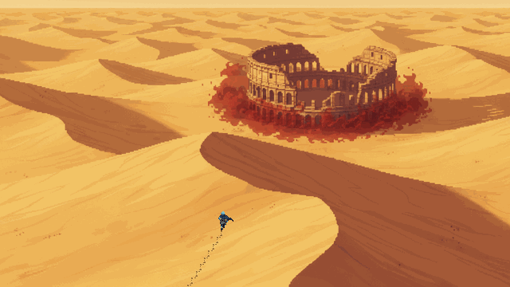

### 1 Nov 2026: A study of what the game is missing next to Alabaster Dawn
- **What:** Danyal asked for the night to go on understanding what's wrong with the game and how to make it better by studying Alabaster Dawn. The findings and an ordered plan are in `docs/ALABASTER_STUDY.md`, with pictures at https://claude.ai/artifact/PGsGv6EbjPAQGxyg9TiNoP. It found four missing layers: sound (0 files), color and light, height, and depth in fights.
- **Changed in the game:** Nothing. The light and ground experiment ran as a throwaway script and was deleted.
- **Shown:** `docs/progress/2026-11-01_study_light_ground_experiment.png`, `study_sprite_palette_test`. Six of Alabaster Dawn's store screenshots are in `docs/refs/alabaster_dawn/` as local references; they're Radical Fish's art, so don't ship them.
- **Checked:** 102 tests pass after the experiment's files were removed. Claude hasn't played Alabaster Dawn, and the measurements are rough.
- **Found:** Restart in the Cinerea pause menu only unpauses, and nothing awards Embers. Neither is fixed yet.

### 1 Nov 2026: His eyes where his eyes are, and Cassia asks who he is
- **His eyes:** The painted eyes were still placed for his old head: on the front stands a row too high and at the edges of his face, on the side stands on his nose, and the clips' own eye marks still showed beside them. They now sit on the row under his brows, where the clips draw them, with the clip's marks cleared first (`art/tools/armed_idle.py`). His side and left walks, runs and sprints take the stand's head, so they're right too. A 5-pixel speck by his head in one front sprint frame is gone.
- **Cassia:** Her first line is now "Who are you? You're either a deserter or a ghost." (`game/talks.gd`). The second sentence stays because the answer "I don't know which." needs it.
- **Why:** Danyal's notes of 1 Nov.
- **Shown:** `docs/progress/2026-11-01_eyes_before_after.png`, `eyes_in_game`, `cassia_who_are_you`.
- **Checked:** 102 tests pass. In the real game: standing and walking from the front, left and right, with and without the sword, and her line on screen.
- **Not done:** His front runs and sprints keep the clips' own eyes, in the right place but dimmer than the stands', because his head there is drawn too differently for the stand's to fit. `DIALOGUE.md` in the Unreal game still has her old line.

### 1 Nov 2026: Cassia walks out of her door, cobbles on the road, one body for him, Hammer Blow aimed by holding F, smooth grass
- **Cassia:** With the raiders dead the carriage's door swings open on its hinge, she stands in the doorway on the sill, and she walks down onto the sand, then on to her strongbox (`art/tools/carriage_door.py`, `CassiaScene`). She no longer crawls out from under it. Her sheets had her feet 1-4 rows above the ground, so she hovered and bobbed: `art/tools/ground_feet.py` puts every frame's feet on the ground, and she no longer does the townsfolk's 1 px standing hop (`Townsperson.bobs`).
- **The road:** The same cobbles as the town's streets, with whole stones at its edges and sand past them, in place of the painted blocks with sand-coloured patches (`art/tools/road_tile.py`, `art/floors/road.png`). It's 5 m wide, as the main street is, so the lake and two milestones moved out to make room. The dark patch where the carriage's shadow crosses the stones is that shadow.
- **Him:** Every stand, walk and run, with and without the sword, comes from clips that start on the same pictures, cut at one scale, and every sheet's skin is brought to one tone. The recipe is in `art/vulcan_human/notes.md`.
- **Hammer Blow:** Hold F. A red ring the size of the blow shows where he'll land, with a cross at its middle and dots leading to it, and it follows the mouse or the stick, up to 8 m (Claude's number). Let go and he leaps there, over anything in the way, and comes down short of a wall if you aimed into one (`Elvis._tick_aim`, `_landing`, `fx/aim_mark.gd`). Holding costs nothing; Space cancels it into a roll, and a scene starting cancels it.
- **Grass:** The tufts are now 4 times the game's pixels, and `core/grass.gdshader` bends each one as a continuous curve, so there are no frames to count and each blade moves a little differently.
- **Why:** Danyal's notes of 1 Nov.
- **Interrupted:** The first run of this work never finished. A shell helper named `cut` called itself, about 230 new shells a minute, until WSL ran out of memory and Claude's tabs were killed. The helper was renamed and the work finished from where it stopped.
- **Art:** 6 clips, 12 credits, 1,745.45 left. `D:\SmartRig\spike\web\clips\vulcan_walk_*` and `vulcan_armed_walk_*`.
- **Shown:** `docs/progress/2026-11-01_cassia_door.gif`, `road_cobbles`, `one_body_all_views`, `one_body_sheets`, `hammer_aim_ring`, `hammer_leap.gif`, `hammer_landed`, `grass_smooth.gif`.
- **Checked:** 102 tests pass, 3 of them new. In the real game: the door scene from the shut door to the strongbox, with her at sill height from its first frame and at 0 m by the end; the leap landing on its mark; the mouse's point on the ground projecting back to the mouse's exact pixel; the road from two places; his walk and run from four directions with and without the sword. His skin measures about (172, 109, 67) in every stand, walk and run.
- **Not done:** Nobody has played this by hand, so F was pressed by a script and the mouse aim was checked by its numbers. His attacks, roll and hurt keep their old cuts, with the new skin tone. Other townsfolk still hop 1 px when they stand, and Fortuna, the raiders and others have the same gap under their feet in some frames. Some of that is on purpose, such as Elvis's flying run frames, so it wasn't changed without being asked.

### 1 Nov 2026: The prologue, the long walk, the lake and the bandits, real runs, footprints, grass, abilities, the new HUD and town wall
- **The story's order (Danyal):** The game opens on the prologue (`game/opening.gd`, STORY.md C0): words on black as sand blows across them, Elvis walking across the desert with the credits and his voice, the colosseum far off under its red haze. Then you walk in across open desert (`Game._cross`), past what earlier challengers left, with the controls taught on the way. After the fight his greatsword goes into thin air; "Who... am I?"; Elvis, turned away, with no name on the words and the letters coming slowly: "I don't know who you were... but it doesn't matter now."; Elvis walks out by the north gate; Vulcan gets up slowly and walks out by the breach as the screen slowly goes black. "The Long Walk" comes up letter by letter, then dust goes by and he walks slowly through the sandstorm (`game/sandstorm.gd`) until the grave stands out of it. That's the tomb, its memory (Danyal's new picture, `art/memories/hammer.png`) and the sword. Jackals and scorpions are scattered about, asleep until he's close, with no raiders. South of them the dark comes down with no words, it lifts on him walking slowly to a lake (`game/lake_scene.gd`), the camera cuts to raiders round Cassia's carriage and she answers them from inside it (`Talks.AT_THE_CARRIAGE`, Claude's lines: it's her and her money they're after), and it snaps back to him. After the fight she climbs out and goes to her strongbox, not saffron.
- **All text:** A spoken line, a title, the opening's words and the credits fade in letter by letter. Enter finishes the fade, the next press moves on (`Hud._faded`). Not hints, signs, answer choices or menus.
- **Him:** A real run on Space, from new clips, in all views with and without the sword (`sprint_*`). Facing left the sword stays in his right hand, now the far one, from a new picture and clips (`*_spear_L`: stand, walk, run); the attacks and the short hurt and drink moves are still mirrored. His side stands have the gold buckle back. `art/tools/steady_sheets.py` runs on everyone: one clean head per view locked on to every frame so faces and eyes stop changing, and shades that only flicker keep their colour. Pixels changing between frames: Cassia 27% fewer, Tullus 25%, Livia 27%, the boy 49%, raiders 26%, Varro 23%, Fortuna 40%; Vulcan and Elvis 6 to 7% by that count, because most of what changes in their big moves is real movement. His eyes are drawn two pixels wide. Walk and sprint speeds are set per character from how the sheets are drawn, every side of a walk takes the same time, and a sheet plays as fast as he's moving, so feet don't slide.
- **On the ground:** Every step leaves a print that thins out and goes, its shape from who made it (`core/steps.gd`: sandal, boot, big boot, paw, scorpion's legs, shoe, child's shoe, hoof), and on sand kicks up a little of it, more at a run. Dry grass on the sand sways on its own and bends away from whoever walks into it (`game/grass.gd`, `core/grass.gdshader`).
- **The town:** Danyal's wall, gate and tower from `docs/refs/town_gate_example.png` (`art/tools/town_walls.py`). He can walk right up to a wall, and the piece he's behind opens a dithered hole round him (`arena/wall.gdshader`). The fountain is cut into columns, each standing at its own part of the rim, and its collision is measured from the picture, so he's never drawn inside it.
- **Fighting:** Skills go on F and Q: E in the Memory Paths puts a learned one on F, then Q, then off, and what he learns goes on the first free key. Hammer Blow is a leap and a slam (`Elvis._use_ability`, `fx/hammer_blow.gd`): 30 stamina, 6 s to cool, 40 damage in 2.8 m, all Claude's numbers. A left click on an enemy locks on to it and still swings; middle click or the stick lets go. Q no longer locks on.
- **HUD:** As `docs/refs/ui/2026-11-01_hud.png`: bars and flasks in the top left corner, embers and drachma as numbers alone in the top right, the skills on F and Q down the right, darkening as they cool.
- **Why:** Danyal's notes of 1 Nov, all of the above.
- **Art:** 10 pictures and 9 clips, 30 credits, 1,757.45 left. Sources in `D:\SmartRig\spike\web` (`r2_*.png`, `vulcan_armed_L.png`, `vulcan_kneel_F.png`) and `clips`; `art/tools/round2_props.py`. The old sheets are in each folder's `before_steady/`.
- **Shown:** `docs/progress/2026-11-01_open_walk.png`, `open_far`, `crossing`, `c3_line`, `long_walk_title`, `storm.gif`, `grave_hud`, `grass_in_the_wind.gif`, `walk_sand_and_prints.gif`, `run_left_sword_far_hand.gif`, `hammer_blow`, `lake_walk`, `lake_cut`, `new_gate`, `wall_hole`, `fountain_in_front`.
- **Checked:** 99 tests pass, 11 of them new. In the real game: every step of the order above from the opening to the town. Over 1,200 fps with vsync off on the plaza. Nobody has played it by hand.
- **Not done:** Hammer Blow is the only skill to use, because forging the rest isn't built; Q stays empty until you move it there. Facing left, his sword swings still change hands. Skipping the desert foes loses them when the dark comes down. `STORY.md` and `DIALOGUE.md` in the Unreal game still have the old order, the cart and the saffron. Elvis's line and the raiders' are Claude's wording; the rest of the opening is `STORY.md`'s.

### 1 Nov 2026: A new frame for the menus, and a clean armed stand
- **What:** All three menu pages have a new frame close to Danyal's reference: stone pillars with lava cracks, iron diamonds, a filigree band with whole flames and a real title plaque. His armed stand is now one clean picture per view where only his breath moves, in the world as well as the inventory, so his eyes stay put and no pale specks come and go.
- **Why:** Danyal: "the top left and top right flames are like half there, and the frame is not as good as it can be", "theres a white outline or parts of it that appear and disappear and also his eyes disappear and reappear".
- **How:** The armed idle clips redraw him every frame: up to 606 of his 1,358 pixels changed from one frame to the next. `art/tools/armed_idle.py` replaces them. The front is his clean empty-handed stand with the sword from the clip under his hand, so he looks the same with or without it; the side and back are one good frame of the clip with everything above the belt 1 px lower on the out-breath, as `art/tools/breathe.py` does. The old sheets are in `art/vulcan_human/strips/idle_spear_*_steel.png`. `art/tools/menu_frame.py` makes the frame from one of 2 new pictures (2 credits, 1,787.45 left). It squeezes the bands a little rather than crop through them, paints out the tools that ran off the picture's bottom edge, and keeps the rare orange: my first palette turned the flames beige. `frame()` in `art/ui/build.py` is gone.
- **Moved to fit:** `GameMenu.INNER` is now 512x266, and the inventory, Memory Paths and map moved inside it. The map is 444x250, from 494x278, remade by `build.world`.
- **Shown:** `docs/progress/2026-11-01_stand_before_after.gif`, `2026-11-01_inventory_idle.gif` (redone), `2026-11-01_inventory_unarmed.png` (redone), `2026-11-01_memory_paths_new_frame.png`, `2026-11-01_map_new_frame.png`.
- **Checked:** 88 tests pass. In the real game: all three pages, both zooms, and his stand in all three views with both swords. The two inventory frames differ only inside the medallion. Nobody has played it by hand.
- **Not done:** His empty-handed side and back stands are still clips and flicker a little, up to 152 of about 1,000 pixels a frame; they weren't in Danyal's note. His run and attacks are clips too. A breath of 1 px is all the movement his armed stand has now, so it's calmer than the clip was. The bottom band's ember pattern repeats where the tools were painted out.

### 1 Nov 2026: A new iron sword you can see, selling up front, the inventory redone with his real idle
- **What:** Cassia no longer sharpens the old sword; she sells a New Iron Sword, which goes straight into his hand. It has a wider, brighter blade in every move, and hits a quarter harder. "I'm buying." and "I'm selling." are now answers when you talk to her, and she also buys the old sword. The inventory is laid out like Danyal's reference: he stands in a medallion doing his real idle in the sword he has on, round slots go on either side, empty ones show faintly what goes there, worn ones get an ember ring, and what he has on is marked in the grid. His health and stamina now show beside the embers and drachma.
- **Why:** Danyal: "make it just but a new iron sword instead", "make it so we can sell things to her as well", "increase the pixels a little bit I wanna see how it looks on him unless it takes too much work", "clean up the inventory theres things missing and outdated view for vulkan in the inventory also make it so he also shows his idle movement in the inventory".
- **How:** I read "increase the pixels" as the new sword's. His blade is the only sizeable cool grey in his sheets, so `art/tools/new_sword_sheets.py` finds it by colour in all 42 sword sheets and grows it a pixel all round, with no redrawing or clips; the results are in `art/vulcan_new_sword/`, and `Journey.look` switches to them. The inventory draws his idle with `CharacterSprite.looped_frame`, from the sheets the game uses. Parts are one Nano Banana picture (1 credit, 1,789.45 left), cut by `art/tools/inventory_art.py`.
- **A rule I added:** she won't buy his last sword, or anything he has on. With no sword he can't attack, so he couldn't earn another (`DIALOGUE.md`: "There's always a way forward").
- **Undoes:** the sharpening in the entry below, and its line "That old legionary blade? Give it here..."; `STORY.md` and `DIALOGUE.md` in the Unreal game still say she upgrades the sword. "Show me your goods." is gone. `art/ui/portrait.png` and `portrait_sword.png` are no longer used, and I left them on disk because `art/ui/` isn't in git.
- **Shown:** `docs/progress/2026-11-01_inventory_idle.gif`, `2026-11-01_inventory_unarmed.png`, `2026-11-01_new_sword_sheets.png`, `2026-11-01_new_sword_in_the_game.png`, `2026-11-01_buying_or_selling.png`; `2026-11-01_shop_buy.png` and `2026-11-01_shop_sell.png` are redone.
- **Checked:** 88 tests pass, including the shop with real key presses, the sword's look switching and his idle running while the game is paused. In the real game: the inventory with empty hands, each sword and the zoomed-out view, and the two swords side by side. Nobody has played it by hand.
- **Not done:** The attack swooshes widened along with the blade and look a little heavy. Helmet, armour and boots slots still have nothing to wear. She doesn't buy flasks or the hammer head. If Danyal meant more pixels on his whole figure, not the sword, that's a much bigger job: the game draws everything at 640x360, so he'd either get bigger than the doors and the townspeople, or the whole game's resolution would have to change.

### 1 Nov 2026: Cassia's shop
- **What:** Cassia's stall is a shop. "Show me your goods." opens a window, drawn as her stall, where you buy flasks, a copper ring and a bronze amulet, pay to have the iron sword sharpened, and sell what you've looted. Foes now leave loot: a jackal a pelt, a scorpion a sting, a raider a bronze buckle, which go straight in the bag with a sign over where they fell. Prices follow her Trust.
- **Why:** Danyal: "Now work on the shop". `STORY.md` says "she buys loot, sells gear, and upgrades the iron sword"; `DIALOGUE.md` has her lines and the Trust table.
- **How:** `ui/shop.gd` extends `GameMenu` for its drawing and pausing; prices and gear bonuses are in `Journey.ITEMS`, her lines in `Talks`. Worn gear changes him through `Elvis.wear_gear` (`Health.set_max`, `Stamina.set_max`), and the sword's damage through `Journey.sword_scale`. Sharpening swaps `iron_sword` for `sharp_sword`, so its name and icon change everywhere and it stays in his hand. The window and 8 icons are 2 Nano Banana pictures (2 credits, 1,790.45 left), made ready by `art/tools/shop_art.py`, which narrows the posts and shortens the awning while the coin and the spice pots keep their shape. Re-run it after `art/ui/build.py`.
- **Numbers, all Claude's call:** red flask 6, green flask 4, sharpening 25 (a quarter more damage), ring 20 (30 stamina), amulet 30 (25 health); she pays 3 for a pelt, 5 for a sting, 8 for a buckle, half price for gear. Wary +25%, friendly -10%, trusted -20%, and the other way round when she buys. The road's 7 foes and her purse come to about 50 drachma, not enough for everything, on purpose.
- **Shown:** `docs/progress/2026-11-01_shop_buy.png`, `2026-11-01_shop_sell.png`, `2026-11-01_shop_broke.png`, `2026-11-01_loot_sign.png`, `2026-11-01_cassia_at_her_stall.png`.
- **Checked:** 87 tests pass, 5 of them new, one pressing real keys from the greeting through buying to leaving. In the real game: every shop screen, the loot sign and both zooms. Nobody has played it by hand.
- **Not done:** Foes don't come back, so the money is limited until quests exist. The anvil and materials aren't built, so she doesn't sell iron scraps or incense yet, though their icons are made (numbers 14 and 15 in `items.png`). No helmets, armour or boots, since worn gear must show on him and that means redrawing every move; a ring and an amulet are too small to show. The sharpened sword looks the same on him; only its icon changes. "I put something aside for you" has no gift behind it yet, and a Hostile Cassia still trades, because Trust can't reach either level yet. Keyboard and pad only, as in the inventory. "Show me your goods." and her "nae room" line are Claude's, not `DIALOGUE.md`'s.

### 1 Nov 2026: Steel sword when he stands, only the fountain's water moves, things stop him where they stand, no shields
- **What:** His sword is steel standing as well as walking. The fountain's stone is one still picture and only its water moves, at the clip's own speed. The fountain is solid now, and so is every lantern post where the post really is; the fences, rock walls, pond, plateau, crater, boulders and stalls got better boxes. There are no shields any more: not in the tomb, the bag or the inventory's slots.
- **Why:** Danyal: "when idle the sword looks rusted", "you didnt need to animate The ENTIRETY of the fountain ... just the water", "i can still go through objects", and on shields, make them visible "OR you can make that so we just dont have shields at al". A visible shield means redrawing every move in every view, with the sword out and away, so I took the second.
- **How:** The armed idle clips kept a warm blade that the palette turned brown; `art/tools/steel_blade.py` recolours it along a line measured for each view. `art/tools/fountain_water.py` makes each stone pixel its most common colour and takes only water pixels from each frame, 32 frames instead of 8 at the same 8 fps. Bugs: the fountain had no collision at all, and thin things had their box at the middle of the picture, while a lantern's post stands 0.56 m left of it (`Cinerea.foot_x`). Checked by drawing every box over the real town: all 9,877 street cells stay reachable from the gate, and he stops at the rim and the post from every side. No credits. `docs/art_list.json` no longer asks for shield art. STORY.md in the Unreal game still has the worn shield in the tomb; it is left as it is.
- **Shown:** `docs/progress/2026-11-01_fountain_water_only.gif`, `2026-11-01_sword_steel.png`, `2026-11-01_stopped_at_the_post.png`, `2026-11-01_inventory_no_shield.png`.

### 1 Nov 2026: You can't get stuck in a talk, no face on the answer box, a real idle for the jackal
- **What:** Closing a conversation no longer starts it again. Cassia's stall ends with "Goodbye." instead of "Nothing today." and she can't be stopped on her way to the stall. His portrait is gone from every answer box. The jackal stands, breathes, sniffs and flicks an ear instead of hanging frozen in one frame of its run.
- **Why:** Danyal: "im stuck in this part of the dialogue, add something like goodbye", "i dont want to be able to see vulkans face for this part of dialogue", "add an idle for the wolf or jackal aswell".
- **How:** The E that closes a last line still reads as just pressed on the next physics tick, and he was still in reach, so `Cinerea._physics_process` opened a new talk at once, with anyone. `_e_pressed` now ignores a press within two ticks of `_busy`; a test presses E through `Input` and fails without it. Idle: `jackal_stand.png` from the old running picture, then a clip (3 credits, 1,792.45 left), both in `D:\SmartRig\spike\cinerea`, then `art/jackal/build_sheets.py` and `sheets_for_game.py`. Side view only, like its run and bite. Its cell grew to 60x34. Scorpions and raiders still have one frame.
- **Shown:** `docs/progress/2026-11-01_jackal_idle.gif`, `docs/progress/2026-11-01_goodbye_no_face.png`.

### 31 Oct 2026: Cinerea round 3: front-on houses, real sizes, Cassia's scene, a picture for the memory
- **What:** Every building is redrawn facing the camera and scaled so its door is as tall as the people, who all share one scale. The wall has no gaps, its east and west runs read as the top of a wall, and he can't get behind any of it. Nothing stands on a street, and a test checks that. The fountain's water moves. Talk hints float over the person, sharp at every zoom. Meeting Cassia is a whole scene like the tomb: the cart shudders, she crawls out, checks her saffron, talks, throws him ten drachma, her camel comes, and they walk off to her stall. The answer you pick is no longer said aloud. The memory is one still picture between white fades. With the sword out he is the same build and colours as without it, and his empty-handed roll has no sword.
- **Why:** Danyal's notes after playing: "make it untill the doors themselves are the same size as the character", "the houses shouldnt be Isometric", "there shoulkd be a whole scen in the same pixel art style as the tomb grabbing", "it should just be a picture of a memory", "he looks chubbier when he eqips his sword and a change in color tone".
- **How:** `VILLAGE` in `game/cinerea.gd` is now in metres, not the picture's pixels as the last entry says. `BEHIND_WALL` keeps him north of a wall's picture, which would hide him, and `SIDE_REACH` keeps his hand off the east and west walls. `IN_FRONT` keeps towers and gatehouses ahead of the wall they cover: the old +0.02 m was less than half a `Pixel.snap` step, so it snapped back level and they flickered at the south corners. `art/tools/town_walls.py` now trims the grey edge that showed as a line where the wall strip repeats. The scene is `game/cassia_scene.gd`, its lines are `game/talks.gd`. Bug found on the way: a hidden parent node never gets its interpolated transform, so she was drawn at the origin; `Townsperson.set_shown` hides only the sprite. The front unarmed stand keeps its old idle because that clip failed twice. 35.5 credits this round, 1,795.45 left. Reference for the houses: `docs/refs/house_example.png`.
- **Shown:** `docs/progress/2026-10-31_cinerea_front_on.png`, `2026-10-31_cassia_meets_him.gif`, `2026-10-31_fountain_water.gif`, `2026-10-31_hint_on_people.png`, `2026-10-31_vulcan_stands.png`.

### 31 Oct 2026: Cinerea rebuilt from Danyal's picture of the town
- **What:** The town now follows `docs/refs/town_example.png`: a brick wall of eight sides with towers, gatehouses north and south, grey cobbled streets from a fountain plaza, house clusters, palms, pools, rocky rises, stalls round the plaza, and the temple with its fire altar and bell to the east, on yellower sand with dunes outside. Six more townspeople stand about.
- **Why:** Danyal: "make the town look better", then "heres an example" with the picture.
- **How:** Everything in `VILLAGE` and `PEOPLE` is placed in that picture's pixels, so it can be moved by comparing with the picture; `Cinerea.town_at` maps them to metres. New sheets made with it as a reference (14.5 credits this round, 1,830.95 left). The straight wall is cut into slices that follow on from each other and sheared 45 degrees for the corners. The cobbles are painted in code, whole stones so the street edges are made of stones, because the image filter kept refusing a cobble texture. The town is about 79 m by 48 m, and it holds 144 fps.
- **Where:** `game/cinerea.gd` (`VILLAGE`, `PEOPLE`, `town_at`, `_town_walls`), `art/props/` (`h_*`, `b_*`, `wall_*`, `gatehouse`, `tower`, `stall_*`, `cliff`, `plateau`, and others), `art/floors/town.png`, tools `art/tools/town_walls.py`, `town_floor.py`, `still_character.py`, six still folders such as `art/villager_man`. Sources in `D:\SmartRig\spike\web` (`town_*.png`).
- **Checked:** 76 tests pass, including every town prop and the wall stopping him and the north gate letting him through. A stitched view of the whole town next to the picture (`docs/progress/2026-10-31_cinerea_town.png`), and real-game captures on the ground. Nobody has played it by hand.
- **Not done:** It is the picture's plan, not a copy of its every house. The south gate is shut because nothing lies beyond it. North-south walls show only their top, as the straight-down camera sees them. The six new townspeople have only a front view, so they don't turn to him. The smith's and the priest's lines are Claude's call.

### 31 Oct 2026: an idle, solid buildings, answers and zoom
- **What:** Human Vulcan breathes when he stands empty-handed from the side and the back, where he stood frozen in a run frame. Props in Cinerea stop him. He answers people: a menu of short choices, then he says the line and they reply, with Trust and drachma moving as `DIALOGUE.md` says. Cassia's first meeting plays after the raiders at her cart die, and then she walks to her stall. The mouse wheel, plus and minus (LB and d-pad left on a pad) zoom the camera.
- **Why:** Danyal: "make him have a Idle it looks like he doesnt have one without weapons", "MAKE it so i cant walk through the structures, also make me be able to have a response to the NPCs ... make it so we are able to zoom in and out with the camera fov". Danyal is sending a picture of how the town should look, so "make the town look better" waits for that.
- **How zoom works:** not a real field of view, because the camera is orthographic. `PixelCamera` draws more or fewer art pixels at a whole number of screen pixels each, so the art stays crisp, from 720 art pixels high down to 180. `Hud` and `GameMenu` scale to stay the same size on screen; at a scale that isn't whole their text is slightly soft.
- **Where:** `game/talks.gd` (every conversation), `game/cinerea.gd` (`_block`, `_talk`, `_raider_down`, `WALK_OVER`, `THIN`), `game/townsperson.gd`, `game/journey.gd` (`trust`), `ui/hud.gd` (`choose`, `pick`), `core/pixel_camera.gd`, `core/controls.gd`, `art/vulcan_human/idle_S.png`, `idle_B.png`, `art/tools/idle_into_sheets.py`.
- **Checked:** 76 tests pass, 5 of them new: answers moving Trust and coin, Cassia's greeting by Trust, zoom steps, every town prop being solid, Cassia coming out. In the real game he walked at a house and stopped at its front; captures of the idle, the menu and both zooms. Nobody has played it by hand.
- **Not done:** The front idle clip failed twice, so his front keeps its old two-frame breathing, which Danyal was happy with. People aren't solid. The colosseum's props stay walk-through, Danyal's earlier choice. The answers for Tullus, the boy and Fortuna and the first choice at Cassia's stall are Claude's call, because `DIALOGUE.md` has no choices for them. "Show me where" to Livia leads nowhere yet: her quest isn't built.

### 31 Oct 2026: Cinerea from the new art, and The Hammer as a real scene
- **What:** The road no longer stops at "To be continued": it runs on through a paved plaza into a walkable village of 76 new objects, with Cassia, Fortuna, Tullus, Livia and her boy, who walk or stand and say their short lines with portraits beside them on E. Scorpions and raiders hunt him on the road before it, with hurt and death in code. The Hammer memory is now a clip through his own eyes: three blows with sparks, ending in a blaze, plus the white flash and shake from before.
- **Why:** Danyal bought 2,000 credits and said "now go", then: "not everyone like the NPCs will be walking around so u can do some idle ones to savecredits" and "you can make a better animation scene for tjat memory path now". 151.5 credits spent, 1,853.95 left.
- **How:** plain `nano_banana` at 1 credit for pictures, `seedance_2_0_mini` at 480p and 2 credits for clips (it looks the same as 720p once shrunk). `nano_banana_2_1` for the one edit plain Nano Banana wouldn't do. `autosprite` failed its test and isn't used. Sources are in `D:\SmartRig\spike\web` (`clips`, `masters`).
- **Where:** `game/cinerea.gd` (`VILLAGE`, `PEOPLE`, `_village`, `_talk`, `_foe`), `game/townsperson.gd`, `game/memory_vision.gd`, `enemy/jackal.gd` (`folder`, `run_key`, `bite_key`, `hp`, `bar_up`), `ui/hud.gd` (`portrait`), `arena/lit.gdshader` (a floor can have broken edges), `art/props/`, `art/floors/plaza.png`, `art/portraits/`, `art/memories/hammer.png`, `art/cassia`, `art/fortuna`, `art/tullus`, `art/livia`, `art/livia_boy`, `art/raider_sword`, `art/scorpion`, `art/varro`, tools `art/tools/sheet_to_props.py`, `npc_sheets.py`, `plaza_floor.py`, `clip_to_memory.py`.
- **Checked:** 71 tests pass, but none is new, so the village, talking, portraits and the new foes have no test of their own. Captures from the real game of the plaza, the street, the temple, a talk, the raiders and the memory (`docs/progress/2026-10-31_memory_hammer.gif`, `2026-10-31_cinerea_plaza.gif`). Nobody has played it by hand.
- **Not done:** Quests, the shop and Cassia's real first meeting; Varro has sheets and no fight; Vulcan's waking, Hammer Blow and forging clips are in `D:\SmartRig\spike\web\clips`, not in his sheets. The camp sheet drew a rock pile instead of the lookout stand. A dirt tile was flagged by the filter three times and dropped. The other regions, icons, menus and story pictures aren't made.

### 31 Oct 2026: a list of every picture the game still needs
- **What:** 208 prompts for still pictures, covering Cinerea, Cinderwood, Boreas, the mountains, shrines and dungeons, items, menus, story pictures, memories and endings, each with its reference pictures and a file name. Danyal generates them on the Higgsfield website with their unlimited models, and saves them in `D:\SmartRig\spike\web`. Nothing from the list is in the game yet.
- **Why:** Danyal: "u tell me what to generate and the picture for it give me a big list including everything". My connection can't use those unlimited models, and Higgsfield's terms rule out me driving the website for them.
- **Where:** `docs/art_list.json` has every prompt and the names of what each sheet holds, in order, for cutting them up later. The reference pictures are in `D:\SmartRig\spike\web\refs`. The page: https://claude.ai/artifact/67Yy1ms6zVu5hXxRFPnSjN
- **Not done:** No model has been tried in this style yet, so the list starts with a test on three of them. Entries marked "my idea" aren't in the story. Characters are stills until they get clips, which cost credits.
- **Which AI (added the same day, Danyal: "in it also tell me which AI to use"):** each card in `docs/art_list.json` has an `ai`. Nano Banana does characters, poses, portraits, sheets and tiles. It beat FLUX.2 Pro on the test sheet at game size beside the game's house: its buildings sit at the house's angle, while FLUX.2 Pro's face straight on and carry words. GPT Image (icons, menu panels) and Seedream 5.0 Lite (full-screen pictures) are starting picks, not tested yet. Both test sheets came out 3:4 with only 6 of the 8 objects, so Nano Banana needs a re-run at 16:9 and Seedream still has to run, which could change who gets the sheets. The plain Nano Banana is older than the `nano_banana_2_1` that made Elvis, which isn't on Danyal's unlimited list.

### 31 Oct 2026: the tomb is a real scene, "Strike the Crown" pops up, and Tab opens the menu
- **What:** E at the tomb now plays a scene of about 25 seconds. He walks up, the slab grinds off the pit and the day dims, a light comes up out of the dark, he kneels, the broken hammer head rises into his hands, he lifts his head to look at it, it blazes and he glows with it. Then the memory: his arm and hammer over an anvil, three blows, each a white flash and sparks, and the metal's glow fills the frame. Back in the world he gets up, kneels again to gather the rest and walks clear, and the jackal comes for him. When Vulcan kneels a little sign over him says "Strike the Crown / Right click: heavy attack". Tab opens the menu as well as turning its pages.
- **Why:** Danyal: "we should have a legit animated scene like he goes and grabs the thing and glows", "dont just make us look like we are runnin and screen freezes", "it should have a little pop up to say Strike the Crown as well with heavy attack", "Tab doesnt work for the menu".
- **Where:** `game/tomb_scene.gd`, `game/hammer_head.gd`, `game/memory_vision.gd` (drawn in code, quarter resolution), `game/cinerea.gd` (`loot`), `core/sprite.gdshader` (`glow`), `arena/arena.gd` (mood `hush`), `ui/hud.gd` (`pop_up`), `game/game.gd`, `ui/menu.gd`, `art/tools/open_tomb.py` (the slab slides further). No credits spent; it uses his existing kneel and look-at-hands art.
- **Checked:** 71 tests pass, 1 new and more checks in others. The whole scene shot at real speed in the game, real Tab and I key presses, and the pop-up over him, on throwaway scenes. Nobody has played it by hand.
- **Not done:** His kneel is only drawn facing the camera, so he kneels beside the pit, not bent over it, and the head floats to him: he never reaches in. There is no art of him taking the sword and shield. The scene can't be skipped; E only hurries its two lines. The memory has no sound, as `STORY.md` nearly asks (it wants a muffled ring).

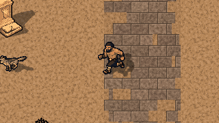
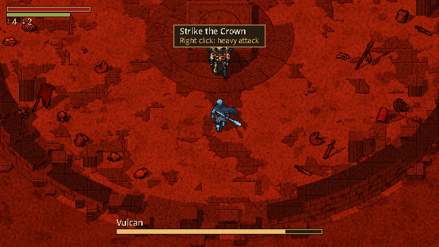

### 31 Oct 2026: a tomb that opens, room to start in, Elvis looking at the man, and health bars on enemies
- **What:** The road now starts with him on the road, the tomb and the jackal in view ahead, instead of 1.6 m from the jackal. As he comes close the jackal backs off the tomb and watches him. E at the tomb turns him to it and its slab grinds aside onto a dark pit, with dust and a small shake, before the loot line. The jackal comes for him after that, as before. In the unmasking, Elvis turns to face the man right after splitting the crown, and stays so through "Who... am I?". Enemies have a small health bar over their heads, in the HUD's style.
- **Why:** Danyal: "it spawns me after the colloseum right on top of a jackal", "during the who am I scene it should be that elvis starts directly looking at vulkan", "make it so the enemies like the jackal have a health bar on top of their head".
- **Where:** `game/cinerea.gd` (`WAKE_AT`, `_shy`, `_open_tomb`, `loot`), `art/tools/open_tomb.py` makes `art/props/tomb_big_open.png` from `tomb_big.png` (no credits), `game/c3_unmasking.gd`, `ui/hud.gd` (`_draw_hud`), `enemy/jackal.gd` (group `enemies`, `BAR_UP`).
- **Checked:** 70 tests pass, 1 new and 5 new checks. The road from the start to the open tomb and the bar at half health, and the "Who... am I?" moment, in the real game on throwaway scenes. Nobody has played it by hand.
- **Not done:** This moves further from `STORY.md`, where he wakes beside the jackal and it charges at once. It stays on Danyal's call, and his no-weapon-no-attack rule. Only jackals are in the `enemies` group, since they are the only ordinary enemy so far; Vulcan keeps his bar in the HUD. The pit is empty: nothing in it shows the sword he takes.

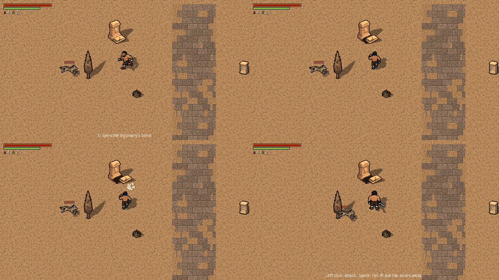
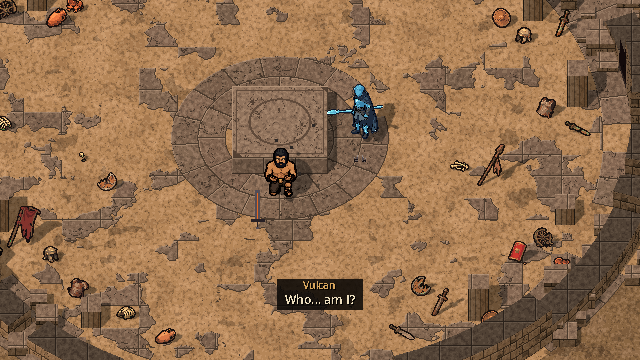

### 31 Oct 2026: the prologue's last card says how to go on
- **What:** After beating Vulcan the card read "Tales of Vulcan / To be continued" and seemed to be the end. E did go on to Cinerea, but its prompt was drawn under the black fade, so it couldn't be seen. Hints are now drawn last, and the card only says "Tales of Vulcan". The card at the end of the road still says "To be continued", because the game really stops there for now.
- **Why:** Danyal: "when i defeat him it says to be continued". The scripted run missed it, because it pressed E itself.
- **Where:** `ui/hud.gd` (`_draw_hud`), `game/c3_unmasking.gd`.
- **Checked:** 69 tests pass. On a throwaway scene the scripted fight reached the card, the prompt now shows in the real picture (left is before, middle is after), and pressing E opened Cinerea (right). Nobody has played it by hand.
- **Not done:** The prompt is small and only appears after 2 seconds.

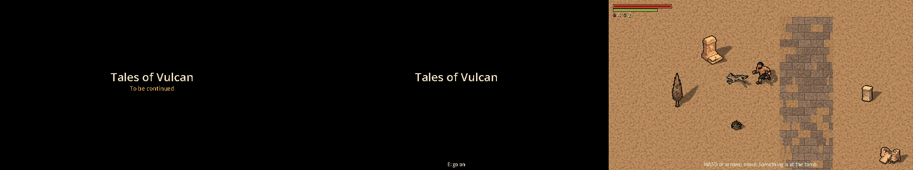

### 31 Oct 2026: the spear really is in his right hand now, facing left
- **What:** The entry below only moved the spear behind him, and his back arm was still drawn gripping it, so it still looked held in the wrong hand. Standing, running, flinching and drawing to the left now use his empty-handed art, with the back hand free, and the spear runs through his front fist, which is his right hand when he faces left.
- **Why:** Danyal: "look its in a different hand when going left".
- **Where:** `art/tools/far_hand_sheets.py` (`EMPTY`, `CLEAN`, `spear_only`, `front_fist`). No credits spent.
- **Checked:** 69 tests pass; the new one now checks that the standing body is exactly the empty-handed one. All four views in the real arena on a throwaway scene, top row left, bottom row right. Nobody has played it by hand.
- **Not done:** The attacks, the roll, the death and the two drinks keep the entry below's way, with the spear rubbed out behind him. In attacks both hands are on it, so that reads right; in the drinks his front hand has the flask, so the back one still grips it. Running left he holds the spear further forward than running right, because the grip moved to the front fist, and it's the stand's level spear, so it doesn't tilt as it does running right. Human Vulcan's sword and the boss's flame sword are still mirrored.

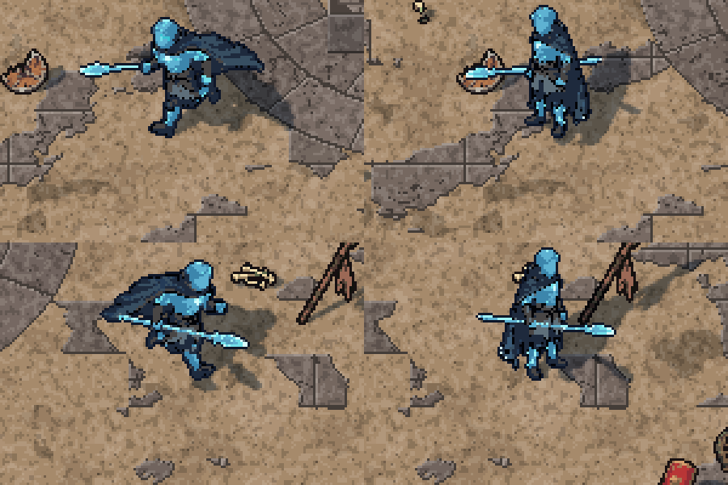

### 31 Oct 2026: the spear stays in one hand when he faces left
- **What:** Facing left he used to be the right-facing art mirrored, which put the spear in his other hand. With the spear out he now has his own left-facing sheets, where it passes behind him, held in his far hand. Top row of the picture is before, bottom row after.
- **Why:** Danyal: "the holding of the spear isnt consistent when he goes left the spear switches hands".
- **Where:** `art/tools/far_hand_sheets.py` makes the 16 `art/elvis_blue/*_L.png` sheets, `core/character_sprite.gd` (`_resolve`) plays them. No credits spent. Empty-handed he still mirrors.
- **Checked:** 69 tests pass, 1 new. The frames of all 16 sheets by eye, and him standing, running and swinging to the left in the real arena on a throwaway scene. Nobody has played it by hand.
- **Not done:** The near arm in the left-facing sheets is still the one that was drawn gripping the spear, so a few attack frames show that hand with nothing in it, and on some diagonal frames a pixel or two of shaft stays over him. A redraw would fix that, at about 70 credits. Human Vulcan's sword and the boss's flame sword are still mirrored, so they change hands too.

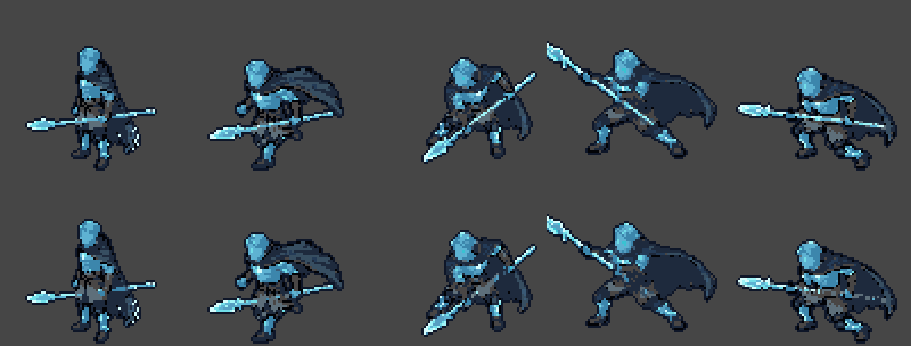

### 31 Oct 2026: the road into Cinerea, the inventory, the Memory Paths and the world map
- **What:** After the prologue's title card, E goes on: a card for the long walk, then human Vulcan wakes by the legionary's tomb with a jackal at it. He has no weapon, so he can't attack. E at the tomb gives the iron sword, the worn shield, 5 drachma and a broken hammer head, and brings back The Hammer (a white-orange flash, its words, Hammer Blow learned). The jackal then turns on him. I opens the menu, where E equips the sword, and it goes into his hand. Two more jackals wait down the road between the tombs. Past the last of them the village comes into view and a "Cinerea, to be continued" card ends it. The menu has three pages, Tab turning them: the inventory (slots round his portrait, three tabs, a description, Embers and Drachma), the Memory Paths (`STORY.md`'s six paths of five skills, closed ones showing "? ? ?") and the world map (painted only where he's been, blank parchment elsewhere). The game draws all the text in its own font. 14 clips and 15 pictures, 88 credits, 5.45 left. `play_cinerea.bat` starts straight on the road.
- **Why:** Danyal: "okay do 1 then 2"; `docs/refs/ui/` are the looks to follow, and "what i have given isnt perfcect". Where they differ the story's names stand. The map's middle is desert, as in `STORY.md`, not the picture's lava.
- **Where:** `game/journey.gd` (autoload: what he carries, remembers and has seen), `ui/menu.gd`, `game/cinerea.gd`, `enemy/jackal.gd`, `player/elvis.gd` (`character`, `has_weapon`, `set_weapon`), `arena/arena.gd` (`prop_sprite`), `art/ui/` (`build.py`), `art/vulcan_human/`, `art/jackal/`, `art/props/`, `core/controls.gd`, `game/game.gd`, `tests/test_journey.gd`.
- **Checked:** 68 tests pass, 6 new: equipping, memories, the map's hidden regions, the menu, the road from the tomb, the jackal. A scripted run on a throwaway copy through the wake, the tomb, the memory, all three pages, the fight, the road and the end, with no script errors. Nobody has played it by hand.
- **Not done:** The story has him fight bare-handed first; here he can't, by Danyal's rule that no weapon means no attack, so the jackal waits until he has looted. Hammer Blow is learned but isn't a move yet, the shield can be worn but blocks nothing, and nothing can be forged or spent (no anvil, shop or Embers). Nothing saves between runs. The menu takes no mouse. His four light attacks, lunge and thrust are one swing; hurt, drink and death show him standing; the jackal has only a side view. The village itself, Cassia, the raiders, quests and the shop aren't built.

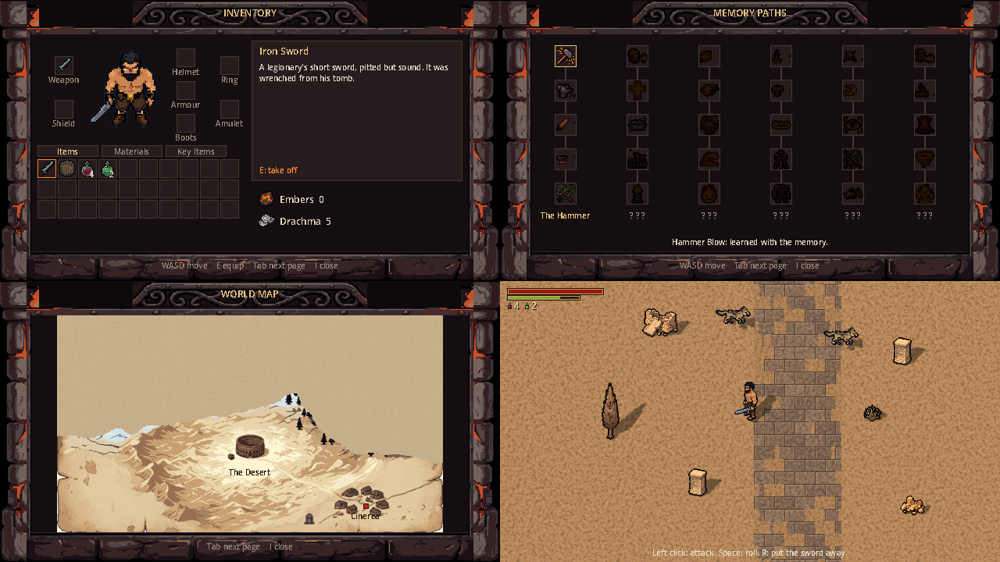
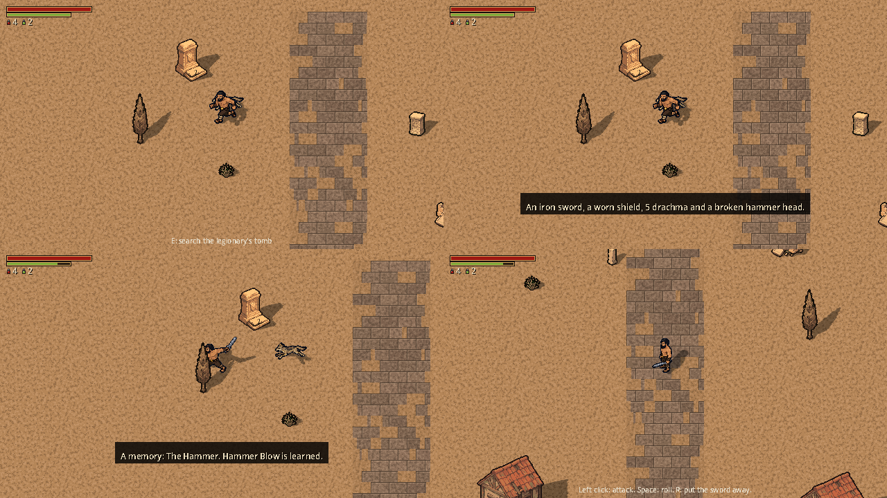
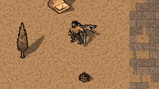

### 31 Oct 2026: the possessed Vulcan's moves, so the prologue is drawn from end to end
- **What:** Vulcan now has a real idle from all three sides, and the slam, slash, backswing, spell, breath, dive, charge and flinch from all three sides, the roar, the kneel, the wake and the statue from the front. The fight's times are unchanged: each sheet's frames are held so its blow lands when `boss/moves.gd` says. The backswing is the slash's sweep played backwards (no credits). 27 clips and 12 pictures, 118 credits, 93.45 left. Mended on the way: the flame that forms his sword still spawned at the old 3.9 m, above his head since the shrink; it now forms at his hand. The crown's effects have their own height when he kneels (`Vulcan.KNEEL_HEAD`). The statue sheet is his own colours and the game turns it to stone.
- **Why:** Danyal: "okay do 1 then 2". This finishes step 1, the prologue.
- **Where:** `art/vulcan_boss/` (`build_sheets.py`, `sheets.json`, `notes.md`), `boss/vulcan.gd`, `game/c1_wake.gd`, `game/c3_unmasking.gd`.
- **Checked:** 62 tests pass. From this folder the opening, `bot=fight fast` and `bot=unmask fast` run with no script errors and no missing Vulcan or Elvis art. Seen: the stone statue with the crown's glow on its head, the storm and blood moods, his attacks with their effects, the kneel, the unmasking and clear skies. Nobody has played it by hand. Seen and left: his runs and walks are the older art at 60%, a little duller than the new moves; the side breath's clip has a small flame of its own under the game's fire; from behind, the dive and charge turn him partly sideways for a frame or two; he keeps his crown on until the armour burns, as he did before, though it has just flown off.

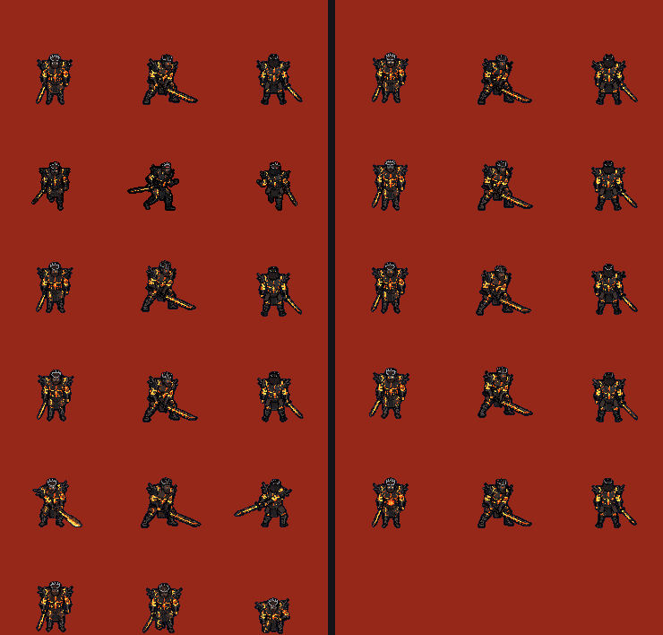
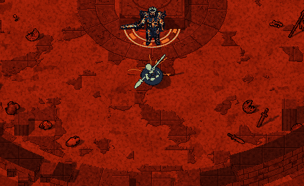
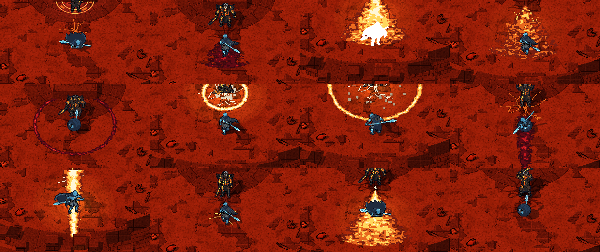

### 31 Oct 2026: the colosseum in ruins, with the remains of old fights
- **What:** The wall is whole only round the north gate. Its east and west sides now fall away in jagged steps to gaps filled with rubble, and ten broken fluted columns stand in from it (they and the rubble that fell inside stop you). The arches and bricks are cracked with bricks missing, the old paving shows through the sand in broken patches with slabs gone, the plinth is cracked with two corners broken off. 32 props lie in small groups near the wall: shields, swords, spears, helmets, breastplates, skulls, bones, ribcages, banners, cart wheels, amphorae and shards. You walk through them, and they take the arena's light, so they turn red with the floor in the fight. 6 credits.
- **Why:** Danyal asked for props and a broken-up colosseum, and chose heavily ruined sides with the gate whole, and props as decoration only.
- **Where:** `arena/arena.gd` (`RUIN_EAST`, `RUIN_WEST`, `STUMPS`, `PROPS`, `_rubble`, `_columns`, `_props`, `_weather`, `_paint_floor`), `arena/prop.gdshader`, `art/props/`, `art/tools/props_to_sprites.py`, `tests/test_arena.gd`. The pictures are in `D:\SmartRig\spike\props`.
- **Checked:** 62 tests pass, one new (props clear of the plinth and of the way in from the breach). A wide shot of the whole arena on a throwaway copy with a bigger screen, in the calm and the blood moods. The wall's collision is still a closed ring, so a gap's rubble stops you where the wall would. Nobody has fought in it by hand yet.

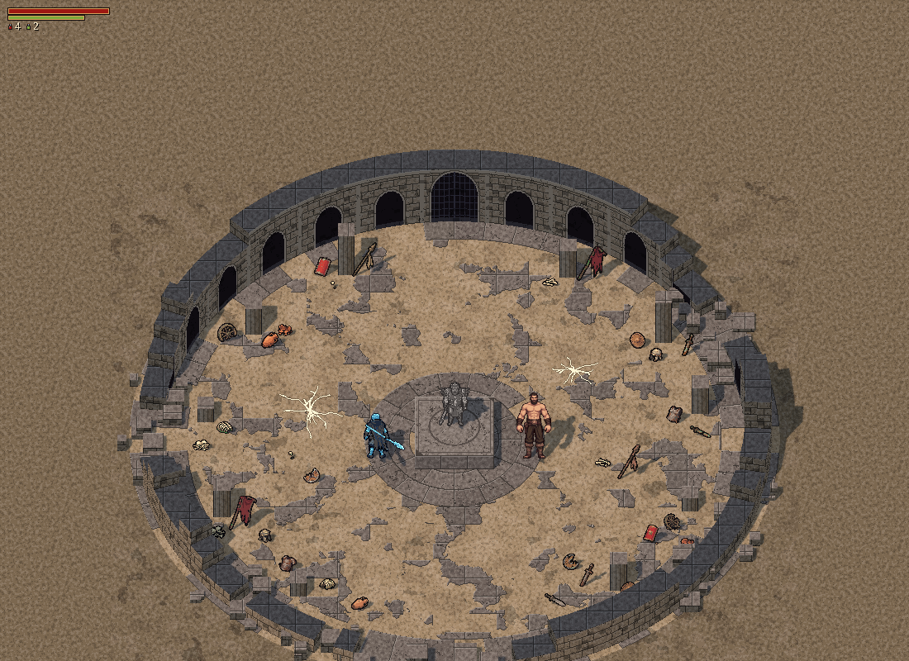
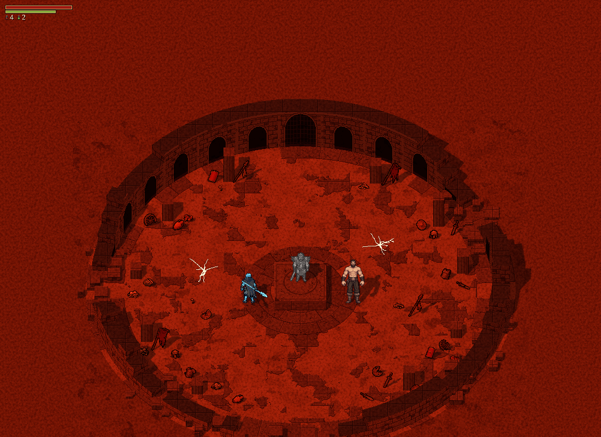

### 31 Oct 2026: the spear can be put away, a walking drink, and cheaper attacks
- **What:** R (d-pad right on a controller) draws or puts away the spear, in 0.4 s; with it away he can't attack and pays nothing. He starts each life with it out. New art: every move but the attacks has a second sheet with the spear (idle, run, roll, hurt, drink, death), plus the equip (the spear grows from ice in his hand; putting it away is the same frames backwards). Moving while he drinks now plays a walking drink at the same point of the drink, with and without the spear, and he turns as he walks. Light attacks cost 10 stamina (were 15), heavy ones 20 (were 30). 27 clips and 12 pictures, 133 credits, 221.45 left.
- **Why:** Danyal: "looks wierd that im attacking without a spear", "make it be equipable and if its unequipped u cant attack", "when drinking potions and moving around looks like im idle drinking", "make it so attacks use up less stamina".
- **Where:** `player/elvis.gd` (`spear_out`, `_look`, `State.EQUIP`, `_tick_drink`, the costs), `core/controls.gd`, `core/character_sprite.gd` (`swap_timed`), `combat/actor.gd` (`_look`), `game/c3_unmasking.gd` (he always has it for the split), `art/elvis_blue/`, `tests/test_elvis.gd`.
- **Checked:** 61 tests pass, 2 of them new (no attacks with the spear away, the walking drink keeps its point). From this folder, `bot=fight fast` and `bot=unmask fast` run with no script errors and no art warnings. Scripted on a throwaway copy: putting it away, a refused attack, running both ways, drawing it, and drinking standing and walking both ways. Nobody has played it by hand. Nothing on screen says the spear is away beyond his empty hands, and a refused attack makes no sound or flash.

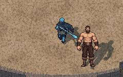
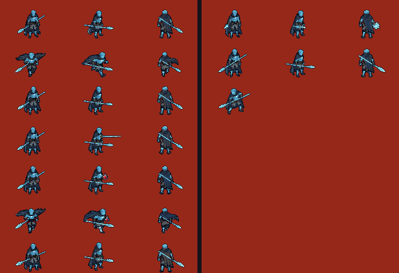

### 31 Oct 2026: all of blue Elvis's attacks
- **What:** Blue Elvis now has every attack in all three views, with the ice spear and hit frames: light 1-4 (a lunging stab, a low sweep, a rising thrust and an overhead slam), the heavy lunge, the charge stance and the charged thrust, and from the front the blow that splits the crown. 25 clips (4 of them retakes) and 2 guard pictures, 106 credits, 354.45 left. Every move the game asks of him now has a sheet; walking and sprinting play the run.
- **Why:** Danyal approved the spear lunge: "make the rest of the attacks".
- **Where:** `art/elvis_blue/` (`sheets.json` holds the hit frames, `notes.md` the prompts that went wrong).
- **Checked:** 59 tests pass. From this folder, `bot=fight fast` and `bot=unmask fast` run with no script errors and no missing Elvis sheets. Scripted combos on a throwaway copy, from behind, the front and the side: each swing plays its own sheet and he travels forward. The light hits now land 0.14-0.21 s in, the next swing can start once the hit frames end (0.33-0.49 s in), and nobody has played it by hand yet. Seen and left: from behind the stabs angle up and to the right, not straight up the screen, and in light 4 from behind the cape hides the spear; the spear appears at once when he swings.

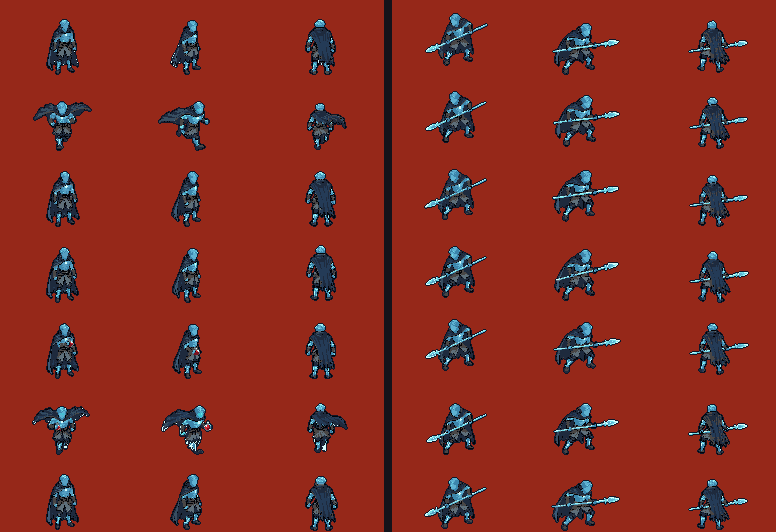
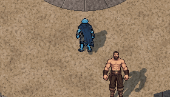

### 30 Oct 2026: blue Elvis's moves, and every spear attack lunges
- **What:** Blue Elvis now has an idle, a roll, a hurt, a drink and a death in all three views, and his first light swing from the side, with an ice spear. Every spear attack carries him forward: 1 m for light 1 and 2, 1.2 m for light 3, 1.8 m for light 4, 1.5 m for the thrust and 2 m for the lunge, plus a short slide as he brakes. When a sheet names its hit frames he surges from the frame before them to their end, so he doesn't skate through the wind-up. Moves with no sheet yet show his idle, still lunging: light 1 from the front and behind, light 2-4, the lunge, the charge, the thrust and the split.
- **Why:** Danyal: "Make sure that the spear attacks ludge you forward". Danyal also bought 500 Higgsfield credits to carry on with the art.
- **Where:** `art/elvis_blue/` (the recipe and limits in `notes.md`), `player/elvis.gd` (`ATTACKS`, `_begin`, `_tick_swing`), `core/character_sprite.gd` (`seconds_to_frame`), `tests/test_elvis.gd` (`test_spear_attacks_lunge_forward`).
- **Checked:** 59 tests pass. `bot=fight fast` and `bot=unmask fast` from this folder: no script errors, and the only art warnings are the missing swings. A scripted side-on swing on a throwaway copy: the long stride, the spear out and the floor sliding by. His light 1 from the side lands about 0.14 s in. Nobody has played it by hand yet, so how far each lunge should go is a first guess.

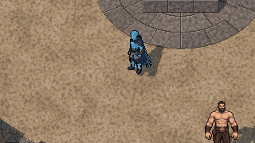

### 30 Oct 2026: blue Elvis replaces the old Elvis, and the characters are smaller
- **What:** Elvis is now the blue ice Elvis, 48 px tall, with real runs from the front, the side and the back. Both Vulcans' sheets were shrunk to 60% (cells 177x117 and 81x60). The flying crown went from 14 px to 8 px across and `Vulcan.HEAD` from 4.0 m to 2.4 m to match; the sword stays, because it's built in metres. Walking and sprinting play the run. (Later the same day he got his other moves; see the entry above.)
- **Why:** Danyal approved the blue Elvis in the Alabaster Dawn style ("absolutely perfect" for the side run, "That is perfect" for all three views), then chose 48 px with Vulcan shrunk after seeing real game screenshots of each size, and an ice spear drawn only in attacks. At 48 px the game's metres fit too: fireballs at 1.2 m, about 25 px up, reach his chest.
- **Where:** `art/elvis_blue/` (sheets, manifest, the recipe in `notes.md`), `player/elvis.gd`, `art/tools/shrink_sheets.py`, `art/vulcan_boss/`, `art/vulcan_human/`, `boss/vulcan.gd` (`HEAD`), `game/crown.gd`, `tests/test_elvis.gd`. The old Elvis stays in `art/elvis`, no longer used.
- **Checked:** 58 tests pass. In the game from this folder (the opening wake, `bot=fight fast`, `bot=unmask fast`): no script errors and nothing falls back to the stand-in; he turns between the three views on one spot; the crown lands small and splits in two, the man kneels and the sword falls. Nobody has played it by hand yet, and foot sliding hasn't been checked.

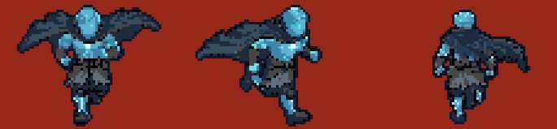
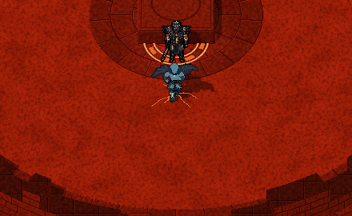
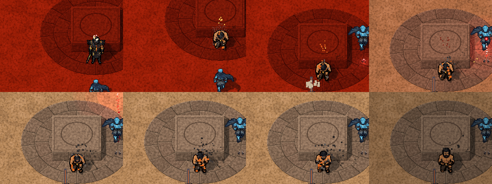

### 25 Oct 2026: Elvis's runs fixed after review: no sliding feet, his long mane, his build from behind, one breastplate (Task A3 review fix, Higgsfield)
- **What:**
  - **Side run:** his feet no longer slide. Gemini's stride sweeps about 27 px a frame under him, twice the ground's 13 px (5 m/s at 12 fps), so now only the passing frames (1 and 5) touch the floor and the other six are in the air, their lowest pixel 2-3 px up. Each foot is down for one frame a step, so a planted foot never moves on the ground. His head rises and falls 6 px.
  - **Side run's hair:** one long streaming mane in every frame, about 40 px from his face to the tips (his idle's length), its tips waving 1 px. Before, each frame had a different short mane.
  - **Front and back runs:** the passing frames stand on the ground. They looked as if they floated because, from the high camera, a foot reaching toward the camera is drawn lower: the front run's forward foot and the back run's kicked-back foot reach 8 px below the planted foot. The keys now say so (`"below": 8`), so in the game the passing feet are on his feet line and his head dips 3-4 px there.
  - **Back run:** remade on Higgsfield. It is now as broad as his back idle (wide pauldrons, the cape to his knees), and its area is 2,600-2,900 px against the idle's 3,000 (it was 2,100-2,300).
  - **Front run and front walk:** the piece of the idle's spear that was pasted with his head by the neck is gone.
  - **Armour:** one breastplate on every frame of the front and side runs and walks, so the silver trim no longer shimmers. Once the frames are lined up, 0-41 of about 475 chest pixels differ in front (it was 70-80%), and 0-30 of 290 from the side.
- **Why:** the review of "Elvis real runs": side-run feet skating at 5 m/s with no flight frame; front and back passing frames floating; the side run's short hair; the thin, short-caped back run; the idle's spear piece in the front head; the armour shimmering.
- **How:** new options in `art/tools/headlock.py`: `--air` (feet a set height above the floor, per frame), `--thick` (the feet are a boot, not the spear's butt), `--mane`, `--clear`, `--chest` and `--cut`. `--bob-max` stays (the boss's runs and walks use it). A back-run guide drawn 1.3 times as broad, `art/guides/E32_elvis_run_B.png` (the new hand key `HK Run Upright`, `guide_pack.py --widen`), with his back idle alone as image 2 (`art/guides/ref_elvis_B.png`). Two Higgsfield pictures (3 credits; 221 credits were left for all lanes at the end). `art/tools/gif.py` now draws a `"below"` key as low as the game does.
- **Where:** `art/elvis/run_F.png`, `run_S.png`, `run_B.png`, `walk_F.png`, `walk_S.png`, `manifest.json`, `make_runs.sh`, `make_walks.sh`, `notes.md`, `raw/run_B_h7.png`, `raw/run_B_h8.png`; `art/tools/headlock.py`, `gif.py`, `guide_pack.py`, `hand_keys.json`, `guide_jobs.json`, `clips.md`, `README.md`; `art/guides/E32_elvis_run_B.png`, `ref_elvis_B.png`, `packs.txt`; `docs/NEXT.md`.
- **Checked:** each sheet at 1x, 3x, 4x and 5-10x next to its idle: only palette colours, alpha 0 or 255, no magenta, nothing pushed out of the cell, the head identical to the idle's. 58 tests pass. In the game (`bot=fight fast`), the back run plays as he runs at Vulcan (picture below).
- **Claude's call:** from the side he touches the ground only in the passing frames, and he flies 2-3 px in the other six. This is a light, bounding run with a 6 px head bob, more than the brief's 2-4 px. Drawing a stride that stays planted for two frames at this speed needs a new guide with the planted foot only about 13 px from his hips; Gemini paints what the guide shows.
- **Claude's call:** the side run's mane is frame 2's streaming hair, stretched 1.3 times, not the idle's hair that hangs straight. Pasting the idle's hanging hair onto a run left Gemini's dark streaming hair round it in blotches.
- **Claude's call:** front and back, "below": 8, and the passing frames are planted. The back run's frame 1 stands 4 px toward the camera, because Gemini drew it less crouched than frame 5.
- **Left as it is:** the front run and walk's arms, legs and cape are still Gemini's in each frame, so their trim changes with the pose; the walk's feet are unchanged. Gemini's side-run stride fits the sprint (7.5 m/s is 27 px a frame at 9 fps); there is no sprint sheet yet.
- **Not checked:** the front and side runs in the moving game (the bot runs north, so the back run is the one on screen).

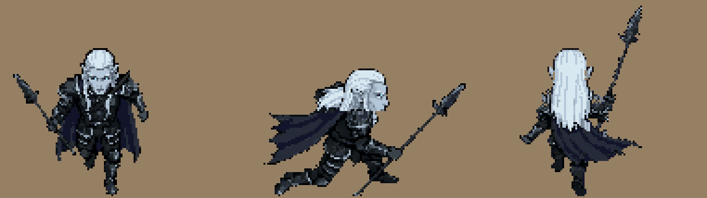
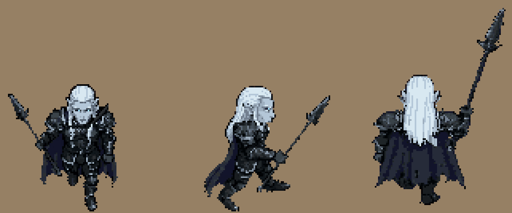
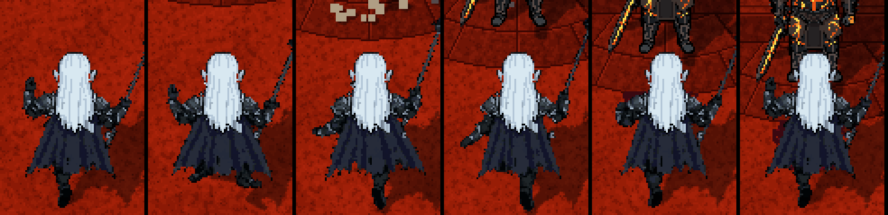

### 25 Oct 2026: the possessed Vulcan runs and walks in all three views (Task A3, Higgsfield; review fix: one sword, feet that travel, one head per view)
- **Review fix (evening):** the reviewer found 2 high and 7 medium problems; all are fixed (picture below).
  - **The side walk held two greatswords** in 2 of its 8 frames and stood in one wide stance in 7 of them, so his feet slid. It is remade: a new guide with the blade trailing flat behind him, off his legs (`art/guides/B32`), and a prompt that asks for one sword and different feet in every figure. Now he holds one sword in every frame, and the heel lands ahead, his weight rolls over it, the back leg swings through and reaches for the next step. The planted boot moves back 15, 14 and 8 px a frame.
  - **The side run's foot contacts didn't form a cycle** (the planted boot stood still for 3 frames, then the contact jumped ahead and behind). It is remade too (`art/guides/B31`, the sword carried level behind him), and built from the four figures that make one real step: contact, passing (the planted boot 12 px further back), flight and reach, with his boots 4 px off the floor in both flight frames.
  - **From behind, the run's frame 1 had no sword:** frame 0's greatsword is now in his fist. **Frame 5 floated 2 px** because its sword tip set the floor: only the boots count now (`headlock.py --floor-half`).
  - **The front run's sword popped** across his legs for one frame: that frame now has the body of the frame before it, so the sword swings out, high, then down. **The front walk's sword never moved:** its blade now swings 10 degrees out and in with each step.
  - **From behind** the walk's head was a flat block (a helmet), and the run's crown had lost its spikes and gems. Both back views now wear one head: the back run's near-black hair under his idle's own crown (ring, five spikes with red tips, the gems). From the side the run and the walk also share one head (the walk's, with its spike tips red again), so walking into a run never changes his head.
  - Two new tools: `art/tools/rekey.py` (3 of the 4 new pictures came back on grey, lilac or a white-pink gradient instead of magenta) and `headlock.py --align` (finds each frame's head with one of Gemini's own heads, since a hand-built head matched 7 px off).
- **What:**
  - **His runs** (`run_F`, `run_S`, `run_B`) are new: heavy full strides with bent knees, the feet travelling forward and back, his free arm pumping, the greatsword swinging with the stride (from the side it is carried level behind him; from the front and behind it swings at his side), his body leaning and bobbing. 8 frames at 14 fps in every view. Until now he glided across the arena in his standing master.
  - **His walks** (`walk_F`, `walk_S`, `walk_B`): slow, weighty steps, the greatsword carried low and trailing; from the front 4 frames at 5 fps, from the side and behind 8 frames at 10 fps (one cycle in 0.8 s in every view). The fight never walks him yet (his pace and approach are both faster than `Vulcan.RUN_FROM`, so he always runs); the walks are ready for cutscenes and slow approaches.
  - **His crown, face and beard never change between frames:** from the front every frame wears his idle's own head (the hand-drawn crown ring, molten eyes and beard); from the side and behind, where he has no idle yet, every frame wears one head per view (`art/vulcan_boss/head_S.png`, `head_B.png`), the same in the run and the walk. Every frame is locked to his palette and stands on his idle's feet row.
  - **From the front Gemini lifted the same leg in almost every figure** (three tries, even with each figure's pose written out), so a new tool, `art/tools/legswap.py`, gives the other half of the cycle that frame's legs mirrored: now the left boot lifts, then the right. The back walk got the same fix.
- **Why:** Danyal: "make it so they run and not just take 1 step of a pixel each"; the boss's walk and run came first in this batch because he glided in his master.
- **How:** new guides from the library's Jog Forward (`HK Boss Run` in `art/tools/hand_keys.json`: the stride and lean eased only 30% toward standing, a full arm swing) and Walk Forward, each packed as one row (`art/guides/B25`-`B30`: a two-row sheet came back with the second row smaller and shorter-legged, so no one feet line fitted it). Higgsfield's `nano_banana_2_1` painted them: 28 pictures (42 credits) for the six sheets, most of them lessons (in `art/tools/README.md`), and 4 more (6 credits) for the review's side remakes. The clean-up is two scripts, `art/vulcan_boss/make_runs.sh` and `make_walks.sh`.
- **Where:** `art/vulcan_boss/run_*.png`, `walk_*.png`, `head_S.png`, `head_B.png`, `manifest.json`, `notes.md` (every raw kept or dropped and why), `make_runs.sh`, `make_walks.sh`, `raw/run_*`, `raw/walk_*` (`run_S_h6`, `walk_S_h7` are the new side raws); `art/tools/legswap.py`, `rekey.py`, `headlock.py`, `hand_keys.json`, `guide_jobs.json`, `README.md`, `gemini_queue.md` (B02 done); `art/guides/B25`-`B32`, `packs.txt`.
- **Checked:** every sheet at 1x, 3x and 4x next to `idle_F`: the same size and build, the head the same pixels in every frame of a view (and the same head in the run and the walk of a view), every colour in `palette.png`, alpha only on or off, no magenta, one sword in every frame; front and back: every frame's lowest boot on row 189; side: the planted boot measured frame by frame (above), the run's flights 4 px up; 58 tests pass. In the game (`bot=boss`) he runs at Elvis from the plinth in `run_F` and stops for his slam (picture: the camera's top edge cuts his crown at that moment; taken before the review fix).
- **Claude's call:** the runs play 8 frames at 14 fps (13 before the fix): from the side the planted boot moves 12 px from contact to passing, 168 px/s at 14 fps, his pace (5.28 m/s = 169 px/s at 32 px/m); at his approach (5.8 m/s) it slips about 10%. Phase two speeds his run and the sprite by the same 1.3.
- **Claude's call:** the side run is one real step drawn twice (Gemini's other four figures were the same mid-stance with the boot standing still), so the same leg leads both steps; in his dark armour at 90 px the near and far leg look alike. The side walk likewise repeats its passing and reaching frames, with a different heel-down frame for each step.
- **Claude's call:** the walks take 0.8 s a cycle in every view, with the front walk 4 frames (the cleanest front picture had 4 figures, each boot lifting in turn). From the side the feet keep up at about 2.8 m/s (9 px a frame at 10 fps), below `Vulcan.RUN_FROM`; at each step's end the back toe holds one frame while the other heel lands.
- **Claude's call:** from behind he wears the same crown as from the front (ring, five spikes with red tips, the gems), not a crown worked out from the back: the spiky ring is what marks him, and Gemini's back crowns had lost it.
- **Claude's call:** he stands 90 px at his tallest running frame (his standing master is 88), and the front and back sheets are widened 1.1 and 1.25 times (the run) and 1.08 times (the back walk), because Gemini drew those views narrower at the pauldrons than the master.
- **Claude's call:** a frame whose head dips more than 4 px under the others is lifted (`--bob-max 4`, as Elvis's runs): only one back-run frame, 2 px, its feet then just off the floor.
- **Claude's call:** the feet are on `idle_F`'s row 189, not the row 190 that `sprites.py` and `breathe.py` use, so starting and stopping don't jump a pixel. Later boss sheets should do the same (`headlock.py --floor 189`), or `idle_F` moves down a row and these sheets with it.
- **Claude's call:** the side and back heads are Gemini's own (no `idle_S` or `idle_B` exists yet). When B01 makes those idles, they should take `head_S.png` and `head_B.png`, so the boss looks the same standing and running.
- **Left as it is:** the armour's lava cracks are Gemini's per frame, so they shimmer a little; the body isn't frozen. From the front the walk's free arm swings only a little. The stride.py walks in the old queue are not needed.
- **Not checked:** the side and back runs and every walk in the moving game (the `bot=boss` run is the front one; the bot's fight keeps Elvis close, so the boss rarely runs); the GIFs are checked by their frame times, not watched.

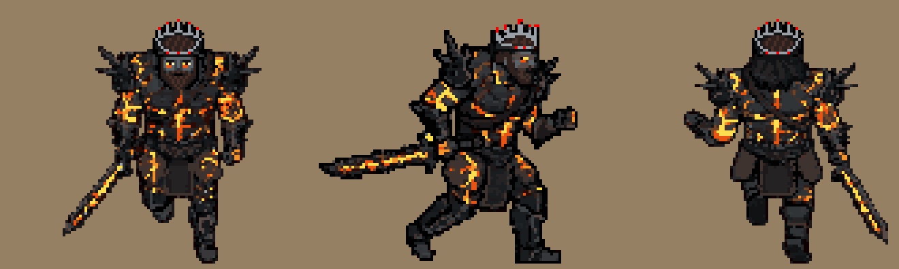
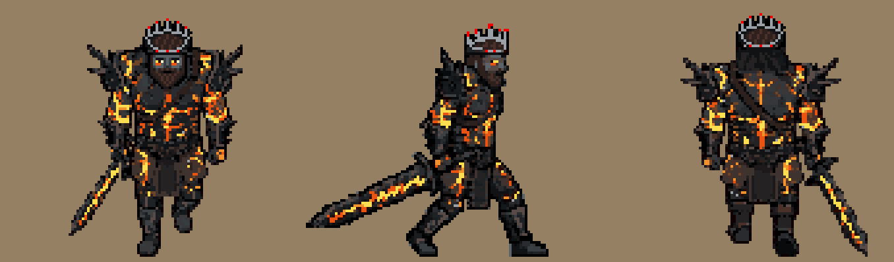
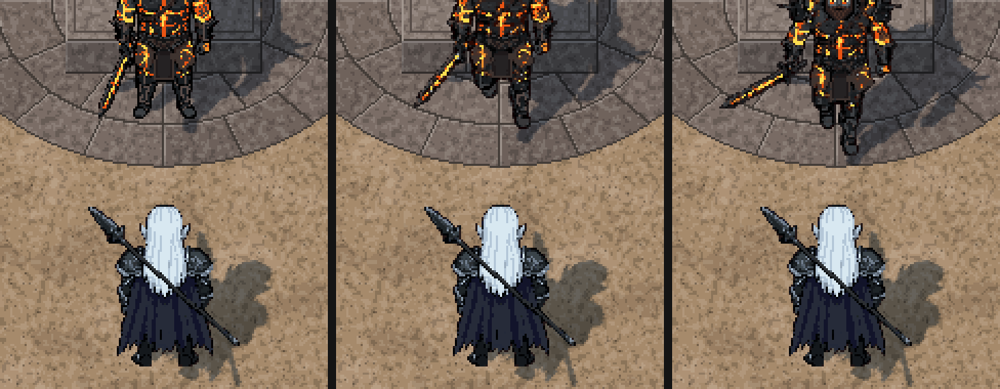
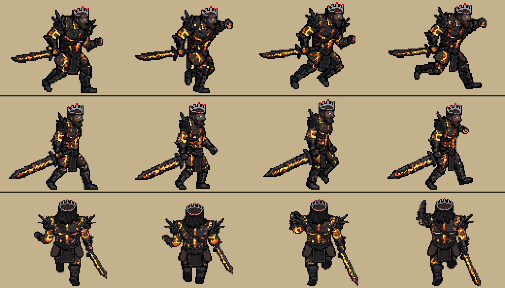

### 25 Oct 2026: Elvis really runs, and walks, in all three views (Task A3, Higgsfield)
- **What:**
  - **The runs** (`run_F`, `run_S`, `run_B`) are new: full strides with bent knees, the feet travelling forward and back, his free arm swinging, the spear rocking in his fist, his body leaning and bobbing, the cape streaming behind him and, from the side, his long white hair streaming back. All three views are the same run: 8 frames at 12 fps. The old runs only lifted the legs a few pixels under a still body.
  - **The walk** (`walk_F`, `walk_S`, `walk_B`, his walk to the crown in C3): real steps, the heel landing ahead and the back foot pushing off, the free arm swinging, the spear upright, the cape swaying. 8 frames at 9 fps.
  - **His face, eyes and hair never change between frames.** Gemini paints every frame anew (every face was a little different and the eyes were lost), so his idle's own head is pasted onto every frame where that frame's head is: from the side the head and face (the hair streaming behind his skull stays the painted one), from the front the head with both eyes, from behind the whole hair down to his waist. Only the limbs, the spear, the cape and the clothes move. Every frame is locked to his palette, and the maroon edge the clean-up leaves round the outlines is removed.
  - (Wrong, see the review fix above: that was an average along an uneven path, and the feet did skate.) The feet don't skate: the side run's planted foot moves about 12 px a frame (145 px/s at 12 fps; he runs at 5 m/s, 160 px/s), the side walk's about 7 px a frame (63 px/s at 9 fps; he walks at 2 m/s, 64 px/s).
- **Why:** Danyal: "make it so they run and not just take 1 step of a pixel each".
- **How:** new pose guides with the full stride of the library's Jog Forward (`HK Run Full`) and Walk Forward (`HK Walk Full`) in `art/tools/hand_keys.json`, packed as `art/guides/E25`-`E30`; Higgsfield's `nano_banana_2_1` painted each view, two of each request, the better kept (17 pictures, about 26 credits; 247 credits are left for all lanes). The clean-up is two scripts, `art/elvis/make_runs.sh` and `make_walks.sh`, with a new tool `art/tools/headlock.py` (the head paste) and new `sprites.py` options for frames Gemini drew at the wrong size.
- **Where:** `art/elvis/run_*.png`, `walk_*.png`, `manifest.json`, `notes.md`, `raw/run_*_h*.png`, `raw/walk_*_h*.png`; `art/tools/headlock.py`, `art/sprites.py`, `hand_keys.json`, `guide_jobs.json`, `clips.md`, `README.md` (the Higgsfield lessons); `art/guides/E25`-`E30`, `ref_elvis_FSB.png`.
- **Checked:** each sheet at 1x, 2x, 3x and 4x next to the idle (the same size and head, both eyes in front, the feet on row 158, only palette colours, alpha on or off); 58 tests pass; in the game (`bot=fight fast`) the back run plays as he runs at Vulcan (picture below).
- **Claude's call:** 8 frames at 12 fps for the run (the old one was 10 at 13), and 9 fps for the walk, from the foot speeds above.
- **Claude's call:** from the front and from behind, Gemini draws the run's passing pose as a deep squat (his head 12 px lower, a hop down at game size), so those two frames are lifted into a flight frame: his feet leave the floor 6-8 px and his head bobs about 4-6 px. (Replaced by the review fix above: the passing frames are planted and the key has `"below": 8`; the back run is a new picture.)
- **Claude's call:** Gemini drew every back view slimmer, longer-legged and smaller-headed than his back idle (4 tries), so the back run and walk are widened (1.36 and 1.29 times) and shortened to his idle's height; the back walk's passing frames still stand taller, so they reach 3 px under his feet line (`"below": 4`).
- **Claude's call:** while running he carries the spear upright in his right hand, tipped forward, instead of the idle's diagonal across his body, so from the front it switches to his right side as he starts to run.
- **Claude's call:** his free fist swings up to head height in three frames of the side run and shows beside his head in three frames of the back run (the camera looks over his shoulder at the forward swing). Kept: it reads as the arm pumping at game size; a lower arm in the guide and the prompt didn't change it from behind.
- **Left as it is:** the armour's fine pattern is still Gemini's in each frame (only the palette is locked), so it shimmers a little; the head and hair don't. The old `stride_run_*.json` recipes and the old walk guide `E23` are no longer used. The GIF draws the back walk 4 px high (`gif.py` ignores `"below"`).
- **Not checked:** the front and side runs and the walks in the moving game (the bot runs north, so only the back run was on screen).

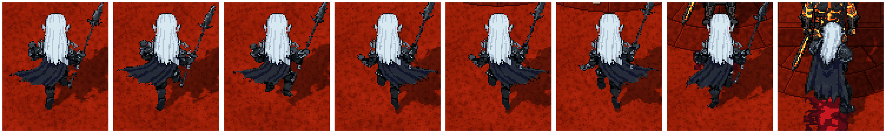

### 25 Oct 2026: human Vulcan redrawn from the game camera, and his C3 kneel and look at his hands (Task A3, Higgsfield; review fix: the gold buckle and a low kneel)
- **What:**
  - **His master** is redrawn from the game's high camera, like Elvis: the top of his head and his swept-back near-black hair seen from above, the tops of his shoulders, short foreshortened legs, the feet from above, and a big head (about a quarter of his height), so his eyes (each a cream white, a pupil and a catch-light, redrawn by hand), brows, beard, the gold lion buckle, the pouch, the wraps and the sandals all read at 80 px. A new palette (32 colours) and a breathing `idle_F` (holds 0.3/0.2 s, like Elvis's).
  - **Review fix, the buckle:** the first palette had no gold, so the buckle came out in skin tans, a skin-coloured lump at his waist. Four golds were added to `palette.png` and the buckle's pixels repainted from the chosen picture's own gold (`touchup.json`); the master, `idle_F`, `master_x4.png`, the reference `art/guides/ref_vulcan_human.png` and the picture below were rebuilt. Nothing else in the master changed.
  - **`kneel_F`** (C3 shot 4), **remade after the review:** he kneels in his trousers where the armour fell, spent, bent far over his knee with his head hanging so only his hair shows, his right arm hanging by the knee: the body of the boss's kneel guide (B07's last pose), 60 px tall against his 80 standing, as low as the guide. The first one knelt upright, 77 px tall, so it would have jumped against a hunched boss.
  - **`look_hands_F`** (C3 shot 7): from that kneel his right hand comes to his belly, both hands rise palms up to his chest, he stares at them (held 0.8 s), straightens a little, then lifts his head and looks at the viewer, eyes open (held to the lines). 6 frames, 4 fps, no loop.
  - **For the boss's kneel:** `art/guides/B07_boss_kneel_F_ref.png` (his master standing in front of B07's mannequins) and a new B07 entry in `art/tools/gemini_queue.md` that asks for the same low hunch and says how low his knelt frame must come out to match the man. The queue's lesson and its recipe line for kneels now agree (the old "`--height 46`" line is gone).
  - **A new tool, `art/tools/guide_with_ref.py`:** a pose guide with the master standing in front of the mannequins at the guide's scale. Gemini painted the kneel as big as a man standing until it saw the two side by side; with it the kneeling man has the master's head and shoulders, and the sheet takes its scale from the standing figure (`--scale-frame 0`), which is then cut off. The lesson is in `art/tools/gemini_queue.md` for the boss's kneel and statue.
- **Why:** the reviewers found human Vulcan drawn front-on at eye level, so he didn't match Elvis; his kneel and look at his hands were the last of his moves (plan Task A3, priority 5).
- **Where:** `art/vulcan_human/` (`master.png`, `palette.png`, `touchup.json`, `idle_F.png`, `kneel_F.png`, `look_hands_F.png`, `touchup_look_hands.json`, `manifest.json`, `notes.md` with every candidate, prompt and command, `raw/`), `art/guides/H02_*`, `H03_*`, `H04_*` and `B07_boss_kneel_F_ref.png`, `HK Human Kneel` in `art/tools/hand_keys.json`, `art/tools/gemini_queue.md` (the kneel lesson, the recipe line, B07, H01).
- **How:** Higgsfield `nano_banana_2_1` (Google's Gemini image model), 1k, 1.5 credits a picture: 8 master candidates and 6 strips (21 credits), then for the review fix 3 kneel strips and 2 edits (7.5 credits). The references went up with Higgsfield's upload; no browser.
- **Checked:** at 1x, 3x and 4x beside his idle: the same man in every frame, the same trousers, wraps and sandals, the buckle gold in every frame, alpha only 0 or 255, no magenta, every colour in `palette.png`, feet on row 94 like the idle. `bot=unmask fast` (frames 300, 330, 880, 1000, picture): the man kneels hunched where the armour burned, at Elvis's scale, then looks at his hands and up for "Who... am I?". 58 tests pass.
- **Claude's call:** master `h5b` of 8 candidates (`art/vulcan_human/candidates_x4.png`): the one that matched Elvis's camera and head size; the rest were front-on, or from above with a head too small to show his eyes at 80 px.
- **Claude's call:** the buckle's four golds are the chosen picture's own (its light, mid, dark and darkest gold), not new colours; at 7x7 px it reads as a round gold buckle, not a lion's head.
- **Claude's call:** kneel strip `look_g3a` of 3: the only one drawn from the guide's camera with the guide's low hunch; `g3b` knelt upright again and `g3c` turned him to the side.
- **Claude's call:** the last frame (head up) is as tall as he stands, 80 px. From this camera an upright kneel is nearly a stand (the front thigh points at the camera and runs down the screen); only the hunch makes the kneel low. Two edits asking Gemini for a lower head-up figure came back just as tall. So the low frame is the first one, the frame the boss's kneel must match, and he straightens up after the swap, as he looks at his hands. His eyes on that frame are the master's (`eyes.py`).
- **Not checked:** the swap against the boss's own kneel: the boss has no `kneel_F` yet (he stands in his idle until he does). B07 in `art/tools/gemini_queue.md` now carries the standing reference, the hunch and the height to check (about 0.75 of his standing height, like the man's 60 of 80).

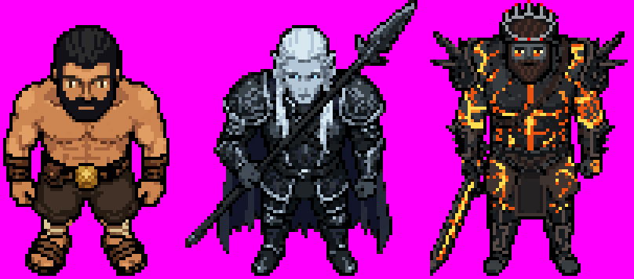

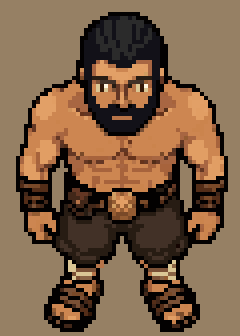

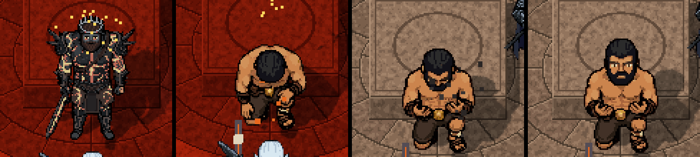

### 25 Oct 2026: the C3 skip command works in PowerShell (Task 6 second review fix)
- **What:** `docs/NEXT.md`'s command to skip the fight and see C3 now starts with `& ` and says to run it in PowerShell, with a note to leave the `& ` out in Command Prompt.
- **Why:** the reviewer found that the line without `& ` fails in PowerShell, which Windows Terminal opens by default ("Unexpected token 'path'"), and a leading `& ` fails in cmd ("& was unexpected at this time"). Checked: Windows PowerShell 5.1 (the only PowerShell on this PC) passes `--` and the words after it through to the game; the same form with the console exe and `fps=3` printed its FPS line, so the game read them.
- **Where:** `docs/NEXT.md` (Play it first, item 3, C3).

### 25 Oct 2026: a move without a sheet keeps the way Elvis faces (Task 6 review fix)
- **What:** when a move has no sheet of its own, Elvis now shows his idle for the way he faces (back, side or front), not always his front idle. Before, every roll, heavy, light 2-4, drink, hurt and death turned him to face the camera; in C3 his heavy on the kneeling Vulcan showed his face while the crown flew, though he stands facing Vulcan. A real character now falls back `anim_dir → anim_F → idle_dir → idle_F → stand-in idle_F`.
- **Why:** the Task 6 reviewer saw him flip to the front in C3 (shots 1-4) and in the bot's fight.
- **Where:** `core/character_sprite.gd` (`_resolve`); new checks in `tests/test_sprite.gd` (a lunge facing back plays `idle_B`; a roll to the left plays `idle_S`, mirrored). `docs/NEXT.md` now says what a move without a sheet looks like.
- **Checked:** 58 tests pass. `bot=unmask fast` frames 240 and 300 (the heavy and the recoil): his back to the camera, facing Vulcan; the log shows `lunge_B` and `charge_B` using `idle_B`. `bot=fight` frames 660-720: his back, facing the statue.
- **Claude's call:** the move's own front sheet still comes before the idle of his view (the plan's order). So if `light2_F` comes before `light2_B`, a light 2 facing back shows the front swing until `light2_B` exists.

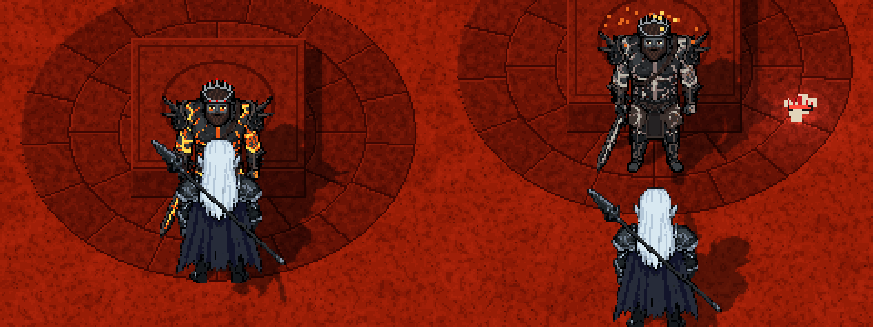

### 25 Oct 2026: Elvis's runs fixed (no flicker, they read as runs), every remaining pose guide made, and the Gemini queue (art review fix, Task A3)
- **What:**
  - **The side run** no longer repaints his head. Its upper body is one of Gemini's frames, kept still; its head is replaced by `idle_S`'s own head with his long hair down his back, so the head and hair are the same pixels in every frame (and the same as when he stands). His hair now reaches his mid-back and streams a little at the tips. Only the legs and the cape's hem come from Gemini's ten frames, put in step order (contact, down, passing, push, reach) and dropped onto the floor line, so a foot is on row 158 in every frame. The maroon `#221616` edge round every outline (a clean-up left-over, 10% of the old sheet) is gone. The spear and his front hand bounce a frame after his body.
  - **The front and back runs** now read as runs: his body bobs and sways a pixel toward the foot he is on, the spear bounces a frame after him, each knee comes forward while its boot lifts behind it and moves in toward the middle, and the cape swings a frame behind. From behind, the hair's tips swing, the cape's hem swings 2 px, and a boot kicked back comes up in front of the cape. Every pixel is still the idle's own, only moved.
  - All three runs are the same run: 10 frames at 13 fps, the same bob and the same step.
  - **Every pose guide Gemini still has to paint** is rendered (74 strips, all in the chunky build), and the known problems are fixed (picture below): the boss's guard is his master's stance, not the library's side-on fencing stance; his slam lands ahead and to his right, so the blade shows from behind (it was hidden in cells 5-6); the dive and light 4 from behind no longer start side-on; the clips that spin (the slash turns 230°, the backswing, the charge, the lunge) are turned back frame by frame, keeping 35° of twist; the front thrusts (light 1, the lunge, the charged thrust) aim ahead and to his left like his front idle's spear, not at the camera. New hand-keyed moves: the boss's spell, breath and wake, human Vulcan looking at his hands, Elvis's held charge and its released thrust (the library's javelin throw pointed the spear every way and stabbed the ground).
  - **Packed for Gemini:** 48 pictures in `art/guides/`, 2 or 3 rows each, every standing figure at least about 190 px tall when Gemini paints the picture 1376 px wide. Fewer, fuller pictures shrank the figures to 70-150 px, too small for faces at 80 px.
  - **`art/tools/gemini_queue.md`:** the 49 requests in order (human Vulcan's master redo, then the plan's order), each with the two pictures to attach, the exact prompt, what should come back, how to clean it and the manifest values. About five Gemini windows.
- **Why:** the art review: the side run's head jittered and was repainted every frame, its hair was too short, its feet floated and the maroon edge dominated it; the front and back runs didn't read as runs at game size. Gemini's limit is reached until 10:07, so the guides and the queue are ready for the next windows.
- **Checked:**
  - Above the hips, 100-280 pixels change between frames of the side run, all of them moves (the hair, the spear); the old sheet changed 1000-1400, all repaints. The eye is on column 136 in every frame (it moved over 5 px). The lowest pixel of every frame of all three runs is row 158. Every colour is in `palette.png`; alpha is only on or off; both eyes in every front frame.
  - The runs at 1x, 2x, 3x and 4x; the guides in every view at game size. The tests pass (58).
- **Where:** `art/elvis/run_F.png`, `run_S.png`, `run_B.png` and their recipes `stride_run_F.json`, `stride_run_S.json`, `stride_run_B.json`; Gemini's cleaned side-run frames kept as the legs' source, `art/elvis/raw/run_S_g2_frames.png`; `art/elvis/notes.md`. Tools: `art/tools/stride.py` (parts from other sheets, regions by line, brightness or colour, sway, lag, knee and boot, per-frame layering, the fringe clean-up, hole filling), `pose_strip.py` (a yaw per frame), `guide_pack.py` (cell picks, the size check), `hand_keys.json`, `guide_jobs.json` (every guide), `clips.md` (each row's guide). The guides: `art/guides/` (`packs.txt`, and `ref_*.png`, each master on magenta). The queue: `art/tools/gemini_queue.md`. Lessons: `art/tools/README.md`.
- **Lessons (what made frames flicker, what fixed it):** Gemini repaints every frame, so a head or chest painted ten times shimmers and pops even when every box is lined up. Frames built from parts that are never repainted don't: one head and one upper body moved by the bob, only the moving legs from Gemini. A run made by lifting the legs under a still body reads as sliding; the bob, a sway, the weapon a frame late, the knee and boot apart and the cape swinging make it read. Check each new sheet for a single colour hugging the outline. More in `art/tools/README.md` and at the top of the queue.
- **Claude's call:** the side run's head is `idle_S`'s, as the review suggested, held upright with the hair streaming only at its tips, rather than Gemini's head leaning into the run. It matches the idle, so turning from standing to running doesn't change his head.
- **Claude's call:** a foot is on the floor line in every frame of every run, so there is no frame with both feet off the ground; the bob gives the lift.
- **Claude's call:** in the back run a boot kicked back is drawn over the cape (it comes toward the camera), and the spear is moved whole across his back with the gaps filled from the hair and cape beside it.
- **Claude's call:** the boss's guard, the start and end of his moves, is his master's stance (the greatsword in his right hand at his side, tip down), so every sheet starts from his idle.
- **Claude's call:** the front thrusts aim about 40° to his left, like the front idle's spear, so the spear shows instead of pointing at the camera. The side and back views keep the straight thrust.
- **Claude's call:** the slam's chest turns 25° to his right for the impact, in every view, so its blade shows from behind; the fire blade still runs straight ahead in the game (about 25° apart).
- **Claude's call:** walks from the front and from behind, and the boss's front idle, are made from the idles with `stride.py` and `breathe.py` (no Gemini); only the side walks go to Gemini. The statue is the wake's first frame and human Vulcan's kneel the first frame of his look at his hands.
- **Claude's call:** human Vulcan's master redo is first in the queue, with Elvis's master as the camera and style reference and his own master picture and game-camera render for the man (his current master is seen from lower than Elvis's and the boss's). His kneel and look at his hands wait for it.
- **Left as it is:** the idles (front, side, back) and the master keep their few `#221616` edge pixels (48-115 per frame); the run's head has them cleaned, so a few edge pixels change as he starts to run. From behind, the boots are mostly under the cape, so the back run reads mostly by the bob, the cape and the hair. `light2_F`, `light4_F` and the boss's `dive_F` dip below his feet in their strikes: build them with `"below"`.
- **Not checked:** the runs in the moving game (only the sheets, the frame strips and the GIF).

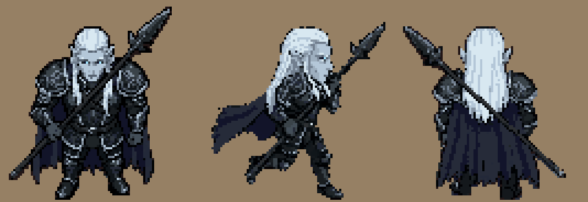
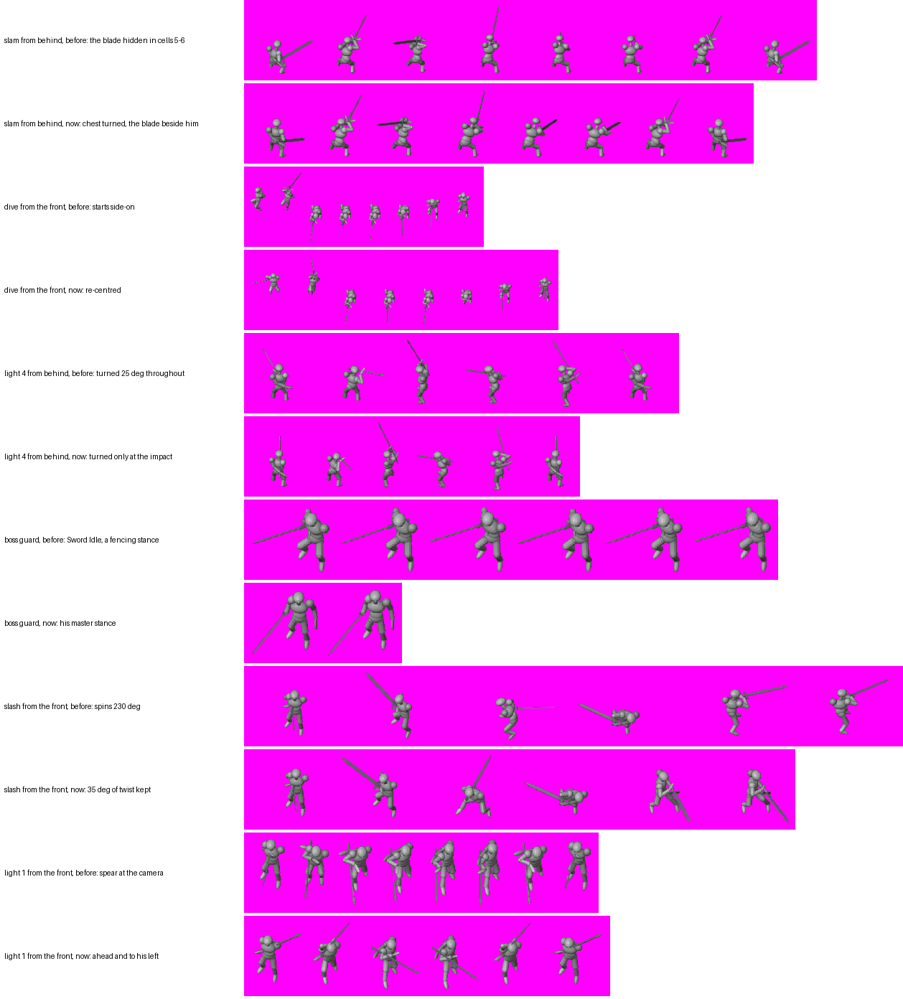

### 25 Oct 2026: smooth on a 144 Hz screen, a camera that leads, full screen at 4x, the reviewers' polish (Task 6)
- **What:**
  - **Smooth on Danyal's screen.** His screen runs at 144 Hz, but the game moves things 60 times a second, so the fighters jumped up to 3 px every second or third frame. Elvis and Vulcan are now drawn where they are between physics steps (Godot's physics interpolation), still snapped to whole pixels: a run moves one pixel a frame, and the camera moves with him. Effects, the camera and the arena snap themselves as before and are not interpolated.
  - **The camera leads** (the spec's "slight lead"): 0.75 m ahead of Elvis at a run, or a quarter of the way toward the foe he is locked on to (at most 2 m), eased in over about half a second, in whole pixels.
  - **Full screen: F11 or Alt+Enter.** It uses exclusive full screen, because Windows' borderless full screen is 2 px short (2560x1438) and drops a 2560x1440 screen from 4x to 3x.
  - **Front attacks can draw below the feet.** A manifest key may say `"below": N`: the cell's bottom N rows are below his feet line. The sprite moves N px toward the camera, so those rows stand over the floor and his feet stay on the same screen pixel.
  - **The statue stood 0.87 m above the plinth.** On the first physics frame Elvis's body was still at the origin, inside the statue, and pushed him up. The stone no longer slides. (Seen in the C1 screenshots.)
  - **C1** frames the crown at the top and Elvis at the bottom, and the crown's glow sits on the crown, not on his face: `Vulcan.HEAD` went from 3.5 m to 4.0 m, measured on the master (the crown is rows 102-114 of the 192 px cell). The crown flies off C3 from there too.
  - **The HUD:** a spoken line has a dark plate under it, so the bronze name reads on the sand. Elvis's bars and flasks are hidden in C3.
  - **Vulcan no longer turns into the stand-in when he walks.** With no walk or run sheet, the boss played the old human-Vulcan sheet tinted red. A character with its own art now glides in its own idle until its walk exists (Review Focus 4's order: a missing animation, then idle, then the stand-in).
  - **The bot** drops its roll-away and press timers when Elvis dies or a cutscene plays.
  - **No GDScript warnings** an editor would show (checked with every default warning turned into an error): integer division in `game/crown.gd` and `core/character_sprite.gd`, the `hurt` signal (Hitbox emits it), the local `gate` in `arena/arena.gd`, and `Controls.move_vector()`, no longer static because it is called on the autoload.
  - **Tests: 58 pass, up from 55.** New: `test_art.gd::test_manifests_valid` (every `art/*/manifest.json` loads, every sheet exists, is one cell tall and at least (start + frames) cells wide), the `"below"` placement, the camera lead. New checks: the statue's height, no fight HUD in C3, a character with no run plays its own idle.
- **Why:** Task 6 of the colosseum plan, plus the reviewers' open polish.
- **Checked:**
  - **Speed:** windowed 1920x1080, `bot=fight`, 20 s, no `--fixed-fps`: **143.7 fps average**, the screen's 144 Hz (vsync), on the RX 9070. With vsync off it runs at 1530 fps. After start-up the worst frame is about 24 ms, once, as C1's lightning strikes; each floor crack takes about 8 ms to paint, one dropped frame at 144 Hz.
  - **Scaling,** on the real screen (ShotDriver's new `screen` capture): exclusive full screen at 2560x1440 is exactly 4x, every 4x4 block one colour, no bars. Borderless full screen (2560x1438) and a 2560x1440 window (Windows shrinks it to 2560x1421) are exactly 3x with black bars. No blur in any of them.
  - **Feel,** at 60 fps every 10 frames over 4 s of the bot's fight, then frame by frame around a hit: a light hit holds both fighters for 4 frames (0.07 s), Vulcan flashes white for 4 frames and the camera shakes 1 px; heavy blows hold 0.09 s and shake 3 px. Elvis is knocked back by slashes and fire; Vulcan takes none, as in Unreal. These read right, so no number changed. Movement, logged frame by frame at 144 Hz: Elvis's sprite and the camera step one pixel together on nearly every frame.
  - C1, the fight and C3 to the title card in screenshots; `bot=fx` and `bot=moves` still run.
- **Where:** `project.godot` (physics interpolation), `combat/actor.gd`, `core/character_sprite.gd` (`below`, interpolation, the fallback), `core/pixel_camera.gd`, `core/controls.gd` (`fullscreen`), `core/shot_driver.gd` (`fps=<s>`, `screen`), `fx/fx.gd`, `game/game.gd` (the lead), `game/c1_wake.gd`, `game/c3_unmasking.gd`, `game/bot.gd`, `game/crown.gd`, `boss/vulcan.gd`, `player/elvis.gd`, `ui/hud.gd`, `arena/arena.gd`, `combat/hurtbox.gd`; tests in `tests/test_art.gd`, `test_sprite.gd`, `test_flow.gd`. Hand-off: `docs/NEXT.md`.
- **For the art lane:**
  - **`"below": N`** (for example `light1_F`): draw the frame with his feet N rows higher in the cell than usual (Elvis's feet on row 158 − N instead of 158), so the spear has the bottom N rows, and add `"below": N` to that key. Keep N to what the spear needs, at most about 30: the sprite also moves N/24 m nearer the camera, so a foe standing less than that in front of him would be drawn behind him.
  - **The crown's height** (`Vulcan.HEAD`, 4.0 m) fits the standing master. A kneeling `statue_F` or `kneel_F` puts the crown lower; give its row to the code so the C1 glow and the C3 crown start there.
- **Claude's call:** physics interpolation for the two fighters only, so a 144 Hz screen is smooth. The cost is that they are drawn up to one physics step (17 ms) behind where they are.
- **Claude's call:** the lead's numbers: 0.75 m at a run, a quarter of the way to the lock target, at most 2 m, easing at 2.5 per second.
- **Claude's call:** F11 and Alt+Enter for full screen, exclusive, so a 1440p screen gets 4x. The game still opens in a 1920x1080 window.
- **Claude's call:** a dark plate under the line, not a lighter name colour, so the name and the words read on sand, blood-red floor and storm alike.
- **Claude's call:** a character with its own art never borrows the stand-in's walk. This changes Task 1's fallback, where run and walk went to the stand-in before idle.
- **Claude's call:** the hit-stop, shake and flash numbers stay as they are (0.07/0.09 s, 1/3 px, 0.08 s).
- **Left as it is:**
  - Each floor crack is painted in GDScript (about 8 ms). Painting a few in advance would remove the dropped frame.
  - The bot rolls away from Vulcan, which along the slam's fire line keeps it in the fire. Danyal plays better than that.
  - Alt+Enter also moves a spoken line on, because Enter is `confirm`.
- **For Danyal:** WSL's D: drive is still broken (since about 06:23). This was done through Windows on a clone in `C:\Users\Danye\AppData\Local\Temp\tv25d_code`.

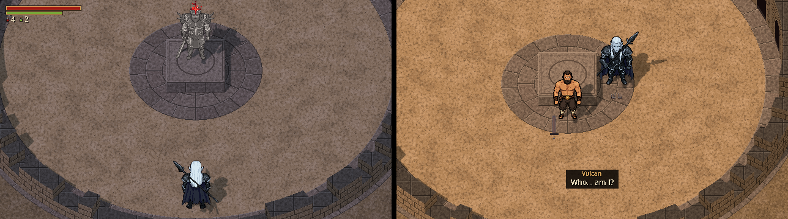
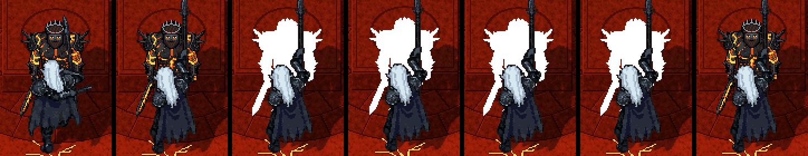
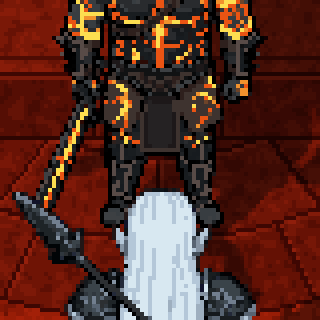

### 25 Oct 2026: fast mode and the earlier screenshot runs work in the game; the bot drinks; the restart tested at bad moments (Task 5 review)
- **What:**
  - **`fast` and `bot=` now take effect in the game.** ShotDriver read the command line in `_ready`, which runs after the main scene is built, so the Game's and the HUD's `fast` and the switch to the old runs were always off. Fast did nothing, and `bot=fx`, `moves`, `calm|storm|blood|clear`, `boss` and `slam|spell|breath|dive` played the normal C1 instead. The Task 5 entry's "The earlier screenshot runs still work" and "Fast mode scales every cutscene wait" were not true until now. ShotDriver reads its args in `_init`.
  - **The bot drinks.** Below 35% health it backs off and drinks red whenever Vulcan isn't winding up or striking, which is mostly right after a roll, pressing every 0.3 s. Before, it waited until it was 4 m clear, which never happened, because he outruns Elvis.
  - **The restart is tested at bad moments.** Elvis now dies mid-drink, with a line showing, three fireballs in flight, two cracks and the storm mood, so the blood-sun check proves the reset. After the restart the test also checks the HUD: no line, the boss bar on, both trails full. A new test kills him mid-swing while Vulcan winds up: both moves are dropped and the restart happens once. The full-run test now checks both C3 lines, in order.
- **Why:** the Task 5 review found fast mode and the old runs broken (high), and two medium issues: Review Focus 3 only partly tested, and the bot never drinking.
- **Checked:**
  - 55 tests pass.
  - Screenshots at 60 fps: `bot=fx` shows every effect at frame 400 again. `bot=unmask fast` is in the fight by 2 s and on the title card by 10 s.
  - A 60 s `bot=fight` run: it drank 5 times over two lives (4 → 3 → 2), each press read at once.
- **Where:** `core/shot_driver.gd`, `game/bot.gd`, `tests/test_flow.gd`.
- **For Danyal:** WSL's D: drive still gives I/O errors. This was done through Windows (`cmd.exe`, `git.exe`, Godot) on copies in `C:\Users\Danye\AppData\Local\Temp\t5fix`.
- **Claude's call:** the bot drinks whenever Vulcan isn't winding up or striking, not only from 4 m away. Otherwise the plan's "drinks red below 35%" never happens. A blow before the gulp breaks the drink off and Elvis keeps the flask, as in Unreal.

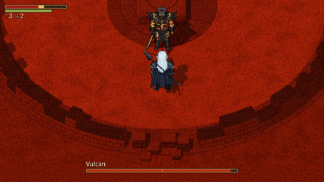
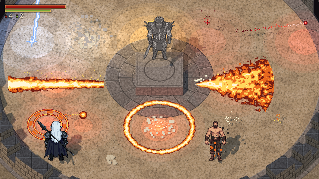

### 25 Oct 2026: Elvis's first light swing from the side and from behind; Gemini's limit stops the batch (Task A3)
- **What:** `light1_S` and `light1_B`, 6 frames each: guard, coil, thrust, full lunge, pull back, guard. Gemini painted them over chunky pose guides, given the master, and they were cleaned to 80 px in his palette with his feet on one line. The coil (the wind-up) is held 0.08 s longer and the full lunge (the impact) 0.1 s longer; the spear hits on frames 2-3 (`"active": [2, 3]`). From the side, each frame has his eye redrawn: a dark pupil and an ice-blue catch-light. The guard that opens and closes the swing is the same frame, and so are the coil and the pull back, so those never flicker.
- **Why:** Task A3, priority 1 (Elvis's roll and light combo).
- **Stopped by Gemini's limit:** the 5-hour window was still at 84% from the batch before. Two pictures took it to 100% at 06:25 ("resets at 10:07 a.m.", weekly 15%); in a fresh chat "Create image" is greyed out. Not made yet: the roll (F, S, B), `light1_F`, and light 2-4 (F, S, B). Their guides are rendered (`art/_work/a3b/`, not committed).
- **`light1_F` failed review and is left out:** Gemini drew the front row smaller and narrower than his idle, with blank faces, plus an extra copy of the master. From the high camera the spear, thrust toward you, runs below his feet, and the sheet has to cut everything below the feet line, so the thrust doesn't read. Facing down, Elvis shows his front idle during the swing until it is remade (the game warns once).
- **Checked:** both sheets at 4x next to his idles, the faces at 10x; every colour from `palette.png`; the guard stands 80 px tall like the idles. The tests pass (54), run from Windows; the only warning is the missing `light1_F`.
- **Where:** `art/elvis/light1_S.png`, `light1_B.png`, `touchup_light1_S.json`, `manifest.json`, `notes.md` (commands and prompts), Gemini's originals `raw/light1_S_g1.jpeg` and `raw/light1_FB_g1.jpeg`. Tools: `art/tools/guide_pack.py` now stacks several strips as rows at one scale (`--aspect 16:9`); `art/sprites.py --scale-frame` lets the guard set the scale (a raised arm counted as body and shrank him to 74 px). Lessons and the limit: `art/tools/README.md`.
- **For the builders:** a front-view thrust needs the sprite to draw below its feet: the spear points at the camera, so on screen it falls below the feet line, where the floor hides a billboard. A manifest value for rows below the feet, with the sprite drawn over the floor there, would let the front attacks show their spear (Task 6).
- **For Danyal:** at about 06:23 WSL lost the D: drive (`/mnt/d` gives "Input/output error"; Windows still sees D:). This entry and the commit were made through Windows git and copies in WSL's `/tmp`. `wsl --shutdown` and reopening the terminal should bring it back.
- **Claude's call:** light 1 uses 6 of the guide's 8 poses (clip frames 46, 36, 32, 26, 36, 44).
- **Claude's call:** with the holds, the hit lands about 0.24 s into the 0.65 s swing, later than Unreal's 0.05-0.20 s; the frames set the timing, as the spec says.
- **Claude's call:** the swing's guard holds the spear level, as in the guide, not low across his body as in the idle, so the swing starts with a quick change of grip.
- **Claude's call:** two views in one Gemini picture (front and back as two rows), and the side view as 2 rows of 3, so the batch fits in about 10 pictures. The back row came out well; the front row didn't (above).

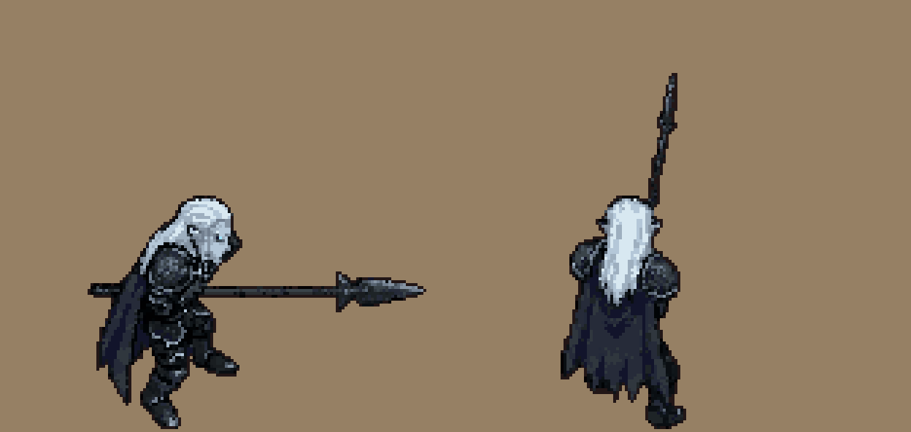
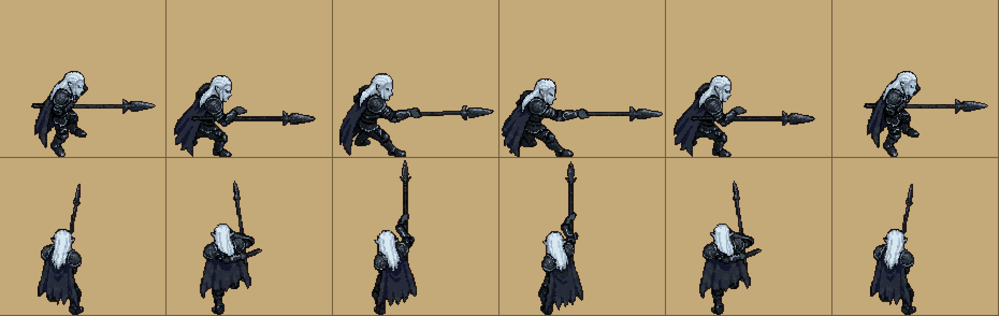

### 25 Oct 2026: the whole snippet plays, from the breach to "To be continued" (Task 5)
- **What:**
  - **The HUD**, in whole pixels at 640x360 in the Unreal HUD's colours: Elvis's health (red) and stamina (green) top left, his red and green flasks with their counts under them. Vulcan's name and bar are at the bottom, with a tick at the half where phase two starts. A gold trail drains behind a bar after a blow. Lines show above his bar, the speaker's name over the words. There is a fade to black, a title card, and a pause menu on Esc or Start (Resume, Restart fight, Quit). Text is drawn with no smoothing: 3 colours at 4x.
  - **The flow:** Elvis comes in at the breach. Within 12 m of the statue, **C1** plays: the camera goes to the stone Vulcan, the crown glows, the storm rolls in (2 s), the sun turns red (1.5 s), lightning bursts the stone, he rises and the flame forms his sword. Then the camera comes back to Elvis, the boss bar shows and the fight starts. At half health he roars and the line "Strike the crown." shows; the fight goes on. When Elvis dies, everything is reset behind a fade to black: both fighters, flasks, stamina, effects, cracks, the blood sun and the HUD, once. C1 never plays again.
  - **C3, the unmasking**, once a heavy blow lands on the kneeling Vulcan:
    1. In slow motion the crown flies off, spinning and trailing embers, and lands in the sand, still beating red. Elvis recoils from the blow.
    2. The lava in Vulcan's cracks cools to grey.
    3. The armour burns away texel by texel, shedding ash, and the man is under it.
    4. The greatsword tips over and lands flat with a clang.
    5. Elvis walks to the crown and splits it; its red light flees north.
    6. The storm clears to warm sunlight.
    7. Vulcan looks at his hands. "Who... am I?" "Whoever you were, you're free." Fade, "Tales of Vulcan / To be continued".
  - **The bot** (`bot=fight`) plays Elvis through the real controls. It walks up, locks on and swings, rolls away from wind-ups within 4 m, backs off to drink below 35% and uses a heavy when he kneels. `bot=unmask` also takes all his health at the start of the fight, so it goes straight on to C3.
  - **Tests:** 54 pass, up from 48. The plan's 5 flow tests are in, plus one more: at 12.5 m nothing happens. A sprite test also checks the new walk fallback (below).
- **Why:** Task 5 of the colosseum plan: the snippet is now one run, start to end.
- **Checked:** screenshots at 60 fps: C1 frame by frame; 48 s of the bot's fight (it died once at about 19 s and the restart faded through black); C3 with `bot=unmask` to the title card; the pause menu. Text, bars and the menu are crisp at 4x.
- **Where:**
  - `ui/hud.gd`, `ui/hud.tscn` (`Hud`).
  - `game/game.gd`, `game/game.tscn` (`Game`, which now holds Arena, Elvis, Vulcan, Camera and Hud as scene children).
  - `game/c1_wake.gd` (`C1Wake`), `game/c3_unmasking.gd` (`C3Unmasking`), `game/crown.gd` (`Crown`), `game/sword_prop.gd` (`SwordProp`), `game/bot.gd` (`Bot`).
  - `core/character_sprite.gd` (the walk fallback), `tests/test_flow.gd`, `tests/test_sprite.gd`.
- **For the builders:**
  - **Additions to the plan's interfaces:**
    - `Game`: the `arena`, `elvis`, `vulcan`, `camera` and `hud` vars; `scaled(seconds)` (x0.05 when fast); `wait(seconds)`, which awaits `scaled(seconds)` on a tween of the Game's, so pausing stops it and freeing the Game drops it. Also the consts `WAKE_DISTANCE`, `FAST`, `DEATH_BEAT`, `DEATH_FADE`.
    - `Hud.fast` (Game sets it) and `Hud.pixel_font()`.
    - `Crown`: `fly(from, to, seconds)`, `split()`, `signal landed`. It extends `FxEffect` for its sprite and light, but lives under the Game, so `Fx.count()` doesn't see it.
    - `SwordProp`: `drop(seconds)` (await it) and `signal fell`.
    - `bot=unmask`.
  - **A test that instances `game.tscn`** can still move Elvis before the first physics frame. That is how `test_c1_within_12m` puts him at 12.5 m and then at 11.5 m.
  - **The earlier screenshot runs still work** (`moves`, `fx`, `calm|storm|blood|clear`, `boss`, `slam|spell|breath|dive`). They skip the flow, and only they bring the training dummy.
  - **Fast mode** scales every cutscene wait, fade and walk; the characters' one-shots (`split`, `look_hands`) keep their own speed.
- **Claude's call:**
  - **C1 starts the moment the game opens.** The entrance is 9.5 m from the plinth, inside the story's 12 m, so ENTER lasts one frame. C1's first 1.5 s (the camera going to the statue, the crown still dull) stands in for "Elvis stops in the sand".
  - **Timings the plan doesn't give:**
    - C1: 1.5 s for the camera to reach the statue, a 0.6 s beat once the sword is formed, 0.8 s back to Elvis.
    - Death: 1.2 s of his death, then 0.8 s to black and 0.8 s back.
    - C3: the crown flies for 1 s of game time (about 2.1 s on screen with the slow motion), lands 2.5 m from Vulcan off to one side, on a 1.5 m arc, spinning 2.5 turns a second. The sword tips over in 0.45 s. Elvis walks at 2 m/s (Unreal's walk to the crown takes 2.7 s, `UnmaskCutscene.cpp` WalkAt to SlamAt). There are 0.5 s beats between shots and a 1.5 s fade at the end.
  - **Elvis recoils 3.6 m** while the crown flies, still facing Vulcan. Otherwise his sprite, in front, hides the kneeling man through shots 2-4.
  - **Elvis stands just north of the crown to split it, facing the camera**, as the art lane will draw `split` (front only), with the crown in front of his feet. The crown splits as his `split` one-shot ends, so its last frame should be the blow.
  - **The armour burns off the man:** human Vulcan kneels one pixel row behind the burning boss sprite, so he shows through texel by texel (STORY.md: "under it is skin"). Then the boss sprite becomes `vulcan_human`.
  - **The sword prop is three unshaded boxes** (the blade with a lava seam, the guard, the grip), not a sprite. It tips toward the camera so it lands flat, face up. Upright it is only 34 px tall: 3D heights are drawn at 21 px a metre, the sprites at about 42.
  - **The HUD:**
    - It uses Unreal's colours (`GameHUDWidget.cpp`, `BossHud.cpp`): parchment text, bronze frames, health red, ember red for him, a gold trail, stamina green.
    - The font is Godot's own, with no smoothing and light hinting, at 12 and 10 px: the other sizes and hintings spaced the letters unevenly.
    - A dark edge round each bar, or it vanishes on the blood-red floor.
    - The trail waits 0.5 s, then drains 60% of the bar a second. The fade steps in eighths.
    - The bar reads "Vulcan" (the plan's call). The title card reads "Tales of Vulcan" over "To be continued".
  - **Walk and sprint fall back to the character's own run before the stand-in.** Elvis's cutscene walk and his sprint now show him running, not the old human Vulcan sheet tinted blue. This changes Task 1's fallback order. Vulcan has no run yet, so he still uses the stand-in.
  - **"Restart fight" in the pause menu only works during the fight.** Elsewhere it just resumes.
  - **Stamina counts as out of combat** (refilling 3x as fast) until the fight starts (STORY.md).
  - **The bot** rolls 0.3 s before a blow lands, inside the roll's i-frames, and runs off for 0.8 s.
- **Left as it is:**
  - The boss sprite still has its crown on while the prop crown flies, until he burns away; a crownless `kneel` sheet would fix it.
  - Until the art lane's `kneel` and `look_hands` sheets exist, both Vulcans stand through C3.
  - The bot rarely wins (it took about 10% of his 600 hp in 48 s), so use `bot=unmask` to see C3.
  - No cutscene bars, no sounds. C2 is the plan's line, not a cutscene.

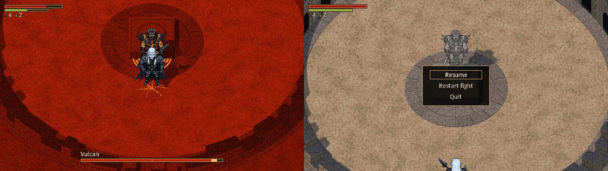

### 25 Oct 2026: Elvis's front and back runs no longer flicker (Task A3 review fix)
- **What:** the front and back runs are rebuilt from his idle stance. Above the waist every frame is now the idle's own pixels, moved only by the bob, so nothing shimmers or pops. The run keeps the master's silver trim, ears, eyes and long locks in front, and the hair to the waist from behind. Turning from idle to run no longer looks like a change of costume. Only the legs move (lifted in turn, up to 7 px in front and 4 px from behind), plus a 0-2 px bob and a 1 px sway of the cape's hem. One foot is on the floor line in every frame. Both runs are now 10 frames at 13 fps (0.77 s a cycle), the same as the side run, so his steps keep their pace when he turns.
- **Why:** the review of the entry below. Gemini repainted the armour in every frame, so it flickered as dark speckle and the head's outline changed (high). The front run had lost the trim, ears and long locks, the back run's hair stopped at the shoulder blades, and the left steps floated 3-7 px above the floor (medium). With Gemini at 84% until 10:07, a redraw would have brought the same repainting back.
- **Checked:** every frame of both sheets: above the hem it equals the idle shifted by the bob, the lowest pixel is on row 158, light pixels 359-360 in front (the master has 360) and 664 from behind (the same as `idle_B`), both eyes in every front frame, every colour from `palette.png`, alpha only on or off. The tests pass (48). The one failure in the run is the code lane's unfinished `tests/test_flow.gd` (Task 5, `Game` not written yet).
- **Where:** `art/elvis/run_F.png`, `run_B.png`, the recipes `stride_run_F.json` and `stride_run_B.json`, `manifest.json`; the new tool `art/tools/stride.py`; `art/elvis/notes.md`, `art/tools/README.md`. Gemini's first versions stay in `art/elvis/raw/` (`run_F_g4`, `run_B_g1`).
- **Claude's call:** in front and from behind, he runs holding the spear across his body as he stands, and his upper body doesn't change. The legs, bob and cape do the running. A run with the arms and spear moving would need a Gemini strip whose legs and arms are pasted onto this body, not a full repaint. The side run stays Gemini's, which the review passed.
- **Claude's call:** the cadence of the side run (0.77 s) for all three views, rather than the 0.6 s and 0.67 s from before.
- **Not checked:** the runs in the moving game (only the sheets and GIFs).

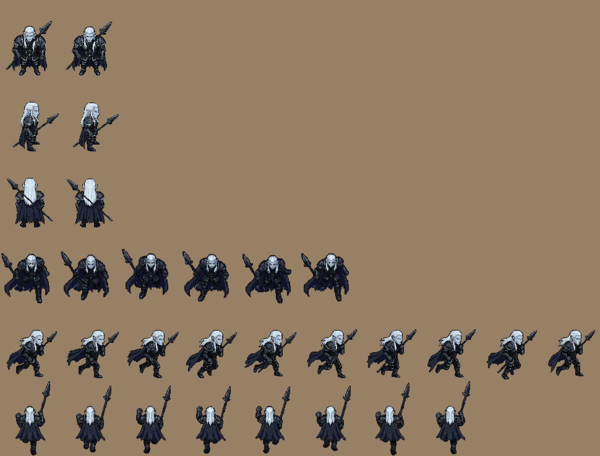
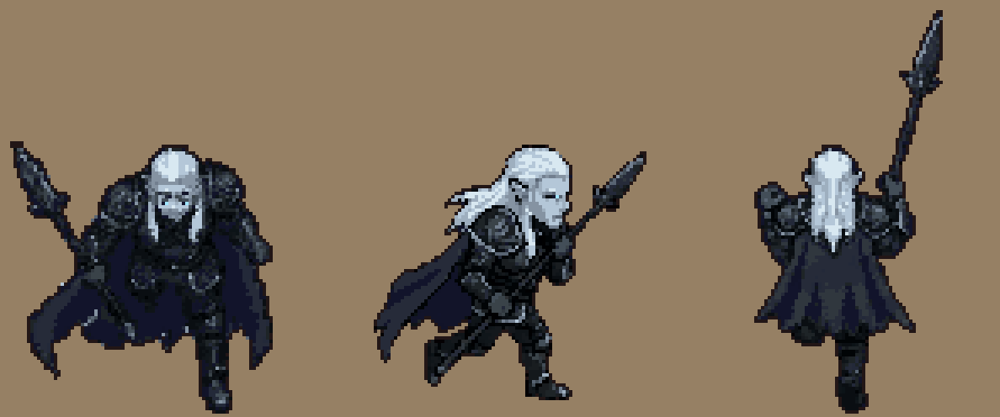

### 25 Oct 2026: Elvis runs in all three views, and his idle turns with him
- **What:**
  - Elvis's run from the front (6 frames), the side (10) and the back (8), and his idle from the side and the back. With the front idle from earlier tonight, he has an idle and a run for every direction. The game picks the view from where he faces and mirrors the side view for left.
  - Gemini painted every frame over a grey pose guide, given the master. The frames were then cleaned to 80 px in his own palette. The eyes were redrawn on every front and side frame: in front, the master's own eyes are placed on each face; from the side, a dark pupil and an ice-blue catch-light. His head stays level as he runs, and his feet stay on one line.
- **Why:** Task A3, priority 1: idle and run are what you see most.
- **Seen (what made it work):**
  - Gemini copies the guide's build. The library mannequin is a tall, thin man, so the first front run came out tall and thin, with a small head and no cape. The pose tool has a new **chunky** build (a bigger head, broad pauldrons, heavy hands and boots, shorter legs). Over it, Gemini's Elvis matches the master.
  - Ask it to "repaint image 1" (the guide) with the master as image 2. Asking for "this character in these poses" made it copy the master's standing pose 8 times.
  - It often pads the picture with extra copies of the master around the strip. `band.py` cuts the strip out.
  - The first chunky front run had no cape and a bare pole for a spear. One follow-up in the same chat added both.
  - The first side run kept one stance in all 8 frames. The second try, which asked it to trace the guide's legs, alternates them.
- **Checked:** every sheet at 4x, and the eyes at 8x. Every sheet is exactly frames x cell wide. The tests pass (48). In the game, Elvis now stands in the colosseum as himself.
- **Where:**
  - `art/elvis/`: `run_F.png`, `run_S.png`, `run_B.png`, `idle_S.png`, `idle_B.png`, `manifest.json`, the eye touch-ups `touchup_run_F.json`, `touchup_run_S.json`, `touchup_idle_S.json`, and every Gemini original in `raw/` (`run_F_g1`-`g4`, `run_S_g1`-`g2`, `run_B_g1`, `idle_SB_g1`).
  - `art/tools/pose_strip.py`: `"build": "chunky"`. The plain build is unchanged.
  - `art/sprites.py`: `--anchor head` with `--bob`, `--anchor strip`, `--pick` and `--split shapes`.
  - New tools: `art/tools/band.py` (cut one row out of a padded picture) and `art/tools/eyes.py` (the eyes, front and side).
  - How each sheet was made: `art/elvis/notes.md`. Lessons and limits: `art/tools/README.md`.
- **Gemini:** 9 images tonight: 1 before the limit, then 8 after it reset at 05:07. It is at 84% now and resets at 10:07 a.m. Each image costs about a tenth of the 5-hour window, and the weekly limit is at 15%.
- **Claude's call:** the front run uses 6 of Gemini's 8 frames. It drew frames 2 and 6 so crouched that his head dropped 13-15 px, a hop at game size.
- **Claude's call:** the head is kept level through the run, with a 1 px bob in front and none from the side or back. Gemini's own heights jumped by up to 15 px between frames. His feet now lift a few pixels in the airborne frames.
- **Claude's call:** the front run keeps the cape over his legs, as you'd see it running toward you. The legs show below the hem and alternate there. Without the cape (the try before) the legs read better but a key detail was missing.
- **Claude's call:** the side and back idles come from one Gemini picture of the stance from both sides, and breathe like the front one. From the side he holds the spear low and pointing ahead. Held across his body as in the front stance, it would cover his face from the side.
- **Claude's call:** in the back idle the spear crosses over his back, as Gemini drew it, rather than being hidden in front of him.
- **Claude's call:** frame rates: run 10 fps in front (0.6 s a cycle), 13 from the side (0.77 s), 12 from the back (0.67 s). The idle breathes once every 1.3 s.
- **Left as it is:** the armour's shading shimmers a little from frame to frame in the runs, because Gemini redraws every frame. In front, the cape hides most of the stride.

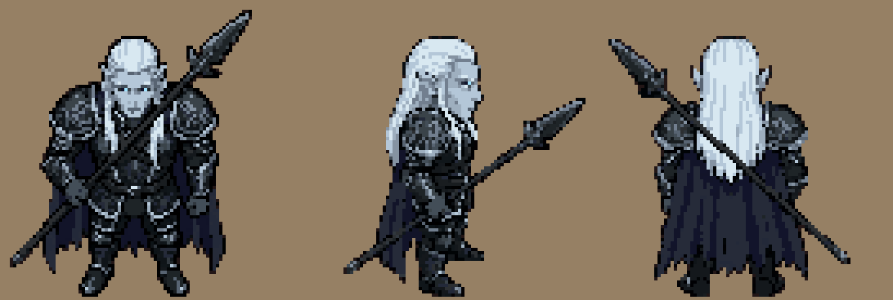

### 25 Oct 2026: Vulcan's breath starts close enough to reach (Task 4 review fix)
- **What:** Vulcan now walks up to 4.8 m before he breathes fire, not 6 m. From 6 m the fire fell short: it reaches 5.45 m from him (5 m of fire from his mouth), so the third opening move missed Elvis every time.
- **Why:** the Task 4 review. The 6 m came from Unreal, where the fire is 7 m long.
- **Where:** `boss/moves.gd` (breath `range`), `tests/test_fx.gd` (`test_breath_reaches_from_its_range`: Elvis 0.5 m beyond that range is still burned; it fails at 6 m).
- **Claude's call:** 4.8 m, which leaves about 1 m for Elvis to step back during the wind-up and still be burned. The fire stays the plan's 5 m.

### 25 Oct 2026: Vulcan's sword follows the sheet's hit frames at both ends (Task 4 review fix)
- **What:** when one of Vulcan's sheets names its hit frames (`"active": [first, last]`), his sword (slash, backswing, charge) now stops hitting once the sheet passes the last one, as Elvis's does. If the first hit frame is past the sheet's end, he no longer waits in the wind-up forever: he strikes when the fixed blow would have ended. 47 tests pass (new: `test_hit_frames`, which fails on the old code).
- **Why:** the Task 4 review: the window's last frame was ignored, and a bad first frame would wedge the fight.
- **Where:** `boss/vulcan.gd` (`_tick_attack`), `tests/test_vulcan.gd`.
- **Claude's call:** the hit frames only end his own sword. The blows that are effects (slam blade, breath, spell volley, dive) keep the fixed times taken from Unreal, and so does the blow's length: the charge keeps moving to the end of its time even after the sword stops hitting.

### 25 Oct 2026: Vulcan, the boss (Task 4)
- **What:**
  - **The statue:** Vulcan kneels on the plinth as grey stone. Until the art lane's `statue` sheet exists, his master is drawn as stone. `wake_scripted()` breaks the stone off. He rises, raises his empty hand, the flame forms his sword (now he is armed), and he steps down off the plinth.
  - **The fight:** he picks a move, walks up to its range, turns to face Elvis, winds up, strikes, then stands open.
    - The opening comes first, in order: slam, spell, breath, dive.
    - Then a mix by distance. Up close (under 3 m) he slashes, and half the time a backswing follows. At middle range he slams, breathes or slashes. Far off (7 m and more) he charges, casts or dives.
    - He never makes the same big move twice running.
  - **Wind-up marks:** while he winds up, a red mark grows on the floor where the blow will land: the slam's strip, the breath's wedge, the charge's lane, and the dive's ring, which follows Elvis until he commits. The spell's circle appears behind him and its 4 fireballs come from it. Slams, dives and slashes crack the floor. A heavy blow that lands on Elvis brings hit-stop and shake.
  - **Poise:** blows wear it down from 100, and at 0 he flinches for 0.75 s. During his wind-ups and blows a hit costs half as much poise and can't break it. It refills 4 s after the last blow.
  - **Phase two at half health:** the crown flares and he roars for 2 s, untouchable. From then on he is 1.35x faster, pauses less and hits 15% harder.
  - **At 0 hp he kneels and never dies.** His attacks stop and every effect is cleared. Light hits only spark; the first heavy hit emits `crown_struck`, once.
  - **Tests:** 46 pass, up from 34. The plan's 9 are joined by 3 more: the brain plays the same fight again after `reset()`; the wake returns with him armed and on the floor; the fight opens with a slam whose fire lands once.
- **Why:** Task 4 of the colosseum plan. The cutscenes and the game flow (Task 5) drive him.
- **Where:**
  - `boss/moves.gd` (`VulcanMoves`), `boss/brain.gd` (`VulcanBrain`), `boss/vulcan.gd` and `boss/vulcan.tscn` (`Vulcan`).
  - `fx/telegraph.gd` (`FxTelegraph`, the marks), `core/sprite.gdshader` (the `stone` look), `player/elvis.gd` (burns don't stun him).
  - `game/game.gd`: the statue on the plinth. `bot=boss` wakes him at once to fight you. `bot=slam|spell|breath|dive` freezes that move late in its wind-up.
  - `tests/test_brain.gd`, `tests/test_vulcan.gd`.
- **For the builders:**
  - **Additions to the plan's interfaces:**
    - `Vulcan.Mode` and `var mode`, `var move`: the bot rolls when `mode == Vulcan.Mode.WINDUP`.
    - `var fast`: the wake's waits run at x0.05. It defaults to `ShotDriver.fast`, so Game should set it from its own `fast`.
    - The `hitbox` child.
    - `VulcanMoves.HEAVY_PUSH` (4.5 m/s); `MOVES` also has `commit`, `turn` and `push`.
    - The Fx kind `&"telegraph"`, shaped by `FxTelegraph.mark()`, and the sprite shader's `stone`.
  - **Instancing `vulcan.tscn` gives the statue.**
  - **The wake:** `wake_scripted()` emits `woke` as it starts and doesn't spawn `statue_burst`, because the plan's C1 does. Nothing can hurt him until it returns.
  - **Resetting:** `reset_fight(at)` puts `at` on the floor and off the plinth, so `reset_fight(arena.plinth())` stands him 1 m south of it. He keeps his `target` and attacks again 0.8 s later, starting with the opening. `start_fight(t)` is what starts him attacking.
  - **Hits:** he takes no knockback (Unreal's boss takes none). Elvis's hurt stun now needs `knockback > 0`, so the breath's burns hurt him without stunlocking him (Task 3's suggestion, and Unreal's rule).
- **Claude's call:**
  - **Unreal's values, not the plan's** (`BossVulcan.h`, `BossVulcan.cpp`, `BossVulcanBrain.cpp`):
    - poise 100 (plan 40);
    - flinch 0.75 s (plan 0.8);
    - backswing after a slash 50% of the time, 75% in phase two (plan 60%);
    - phase two 1.35x (PhaseTwoRate).
  - **Move timings** come from Unreal's clip times and play-rate curves, worked out as its `RealSeconds()` does. For example, the slam is a 0.82 s wind-up, a 0.16 s chop and 0.79 s open.
  - **From Unreal where the plan has no number:** pauses of 0.5-1.2 s (x0.6 in phase two), x1.15 damage in phase two, a 5.8 m/s approach, 200°/s turning, each move's range and turn rate, 4 fireballs 0.3 s apart, the dive's 2.4 m height, the dive mark following at 5.5 m/s, and the wake's beats.
  - **My own numbers:**
    - The charge, which Unreal doesn't have: a 0.6 s wind-up, then a 7 m rush at 10 m/s from up to 8 m away, 20 damage, a heavy blow.
    - The roar lasts 2 s. Unreal's phase shift lasts 3.8 s, but that includes a kneel and a rise.
    - The fireballs fly at 1.2 m, clear of the plinth's top. The breath starts 0.45 m ahead of him.
  - **Phase two speeds up his walk and run too** (the plan: "his speed"); Unreal only speeds up his clips. Approaching, he is then faster than Elvis's sprint.
  - **Up close he only slashes**, as the plan's distance bands say. Unreal still mixes in the slam and the others up close. Danyal may prefer the mix.
  - **Marks on the floor during wind-ups:** not in the plan, but Unreal has the strip, the wedge and the dive mark. Without them the stand-in's wind-up shows nothing.
  - **The wake's order is the plan's:** he rises, the flame forms the sword, then he steps down. Unreal's 24 Oct version summons the sword while he still kneels, then rises.
  - **The boss's stand-in is tinted lava red.** He has no walk or run sheet yet, so he falls back to the old human Vulcan sheet, which otherwise looks like the unmasked man.
  - **Left out:** the slam's 8 s cooldown (the brain has no clock, and "never twice running" does the job), phase two's fifth fireball, and the breath slowly turning after Elvis (8°/s).
- **Not done:** sounds.

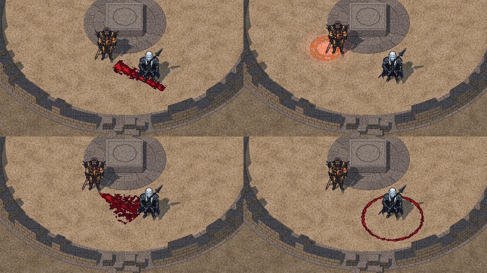

### 25 Oct 2026: the effects light the floor in hard rings (Task 3 review fix)
- **What:** the glows of the effects (lightning, dive, fire blade, breath, spell circle, fireball and the rest) used to paint smooth gradients on the floor and walls. Now they land in hard rings, each twice as bright as the one outside it, with nothing beyond the faintest ring. The sun and the moods look the same as before. The effects screenshot went from 34,499 colours to 5,010; without effects the arena has about 1,100. 34 tests pass.
- **Why:** the Task 3 review: the effects must be pixel art, and the spec's anti-goal is "any smoothing". This was listed under "Not done" in the entry below.
- **Where:** `arena/lit.gdshader` (new), used by every floor, wall and plinth material in `arena/arena.gd`; a comment in `fx/effect.gd`. The effects' lights keep their strengths and reaches.
- **Claude's call:** stepped light instead of weaker or no lights, so the fire still lights the arena. Steps are powers of two, rounded to the nearest, and the faintest is 1/16 of full. The arena's lighting is now plain Lambert with no direct shine, where Godot's default material used a slightly different diffuse model and a faint highlight; at roughness 1 the difference is too small to see in the mood screenshots.

### 25 Oct 2026: the colosseum and the fight's effects (Task 3)
- **What:**
  - **The arena:** `play.bat` now opens in the colosseum.
    - The floor is round, 22 m across: sand with stone paving round the plinth and along the wall.
    - The wall is tall to the north, with 28 arches and the gate in the middle. It crumbles round the sides and is low ruins to the south, where Elvis comes in through the breach.
    - Rubble fills the breach: the wall's collider is closed all the way round.
    - The plinth is a 3 m stone block, 0.75 m high, at the centre.
    - Everything is built in code, one texel per screen pixel, as in the test room.
  - **Moods:** calm (a dusty day), storm (dark grey-purple), blood (a red sun) and clear (warm gold), each blending over any number of seconds. The lightning flash is a light of its own, so it never upsets a blend.
  - **Floor cracks:** they glow white-hot, then yellow, orange and dark red, and go cold in 6 s. Each one is a new jagged pattern with a dark broken edge. At most 24 are kept.
  - **Effects:** `Fx.spawn()` makes 14 kinds:
    - fire blade, fireball, spell circle, breath and dive landing, which all hit;
    - lightning, statue burst, flame summon, crown glow and crown light;
    - ash, sparks, dust and embers.

    The fire is drawn on the floor's pixel grid: hard colour steps, redrawn 12 times a second like hand-drawn frames. Particles are small squares of solid colour.
  - **Tests:** 34 pass, up from 25. The plan's five are joined by four more:
    - a fireball hits once and bursts;
    - the breath burns 4 times in 1.2 s;
    - `clear_all()` stops every blow at once;
    - nobody walks out through the breach or through the plinth.
- **Why:** Task 3 of the colosseum plan. The boss (Task 4) and the cutscenes (Task 5) use these.
- **Where:**
  - `arena/arena.gd`, `arena/arena.tscn`, `arena/crack.gdshader`.
  - `fx/fx.gd` (the autoload `Fx`), `fx/effect.gd` (the base class `FxEffect`), `fx/ground_fire.gdshader`, and one script per kind in `fx/`.
  - `tests/test_arena.gd`, `tests/test_fx.gd`.
  - `game/game.tscn` holds the Arena; `game/game.gd` puts Elvis at the entrance. The screenshot options `bot=calm|storm|blood|clear` show a mood, and `bot=fx` freezes every effect at its height.
- **For the builders:**
  - **Additions to the plan's interfaces:**
    - `class_name FxEffect`: what `Fx.spawn()` returns. Its `hitbox` is public, so connect to `hitbox.landed` for `Feel`. It also has `life`, `age` and `end()`.
    - Rotating an effect turns its fire and its hitbox together, so the breath can follow him as he turns.
    - Arena constants: `WALL`, `TALL`, `PLINTH` (half its side), `PLINTH_H`, `MAX_CRACKS`, `COOL_TAU`.
  - **The plinth:** `plinth()` is the middle of its top, 0.75 m up, where the statue kneels. Actors float with no gravity, so Vulcan stays 0.75 m up until something puts him back at y 0. His wake should step or leap him down. `reset_fight()` should get a floor point, for example `Vector3(0, 0, Arena.PLINTH + 1.0)`.
  - **The wake distance:** `entrance()` is 9.5 m from the plinth, inside the plan's 12 m wake distance, so C1 would start the moment the game does (Task 5).
  - **The breath:** it burns every 0.3 s (the plan), but Elvis's hurt stun lasts 0.4 s, so he can't roll out of it. Unreal's burns have no push and skip his hit reaction. Suggestion for Task 4: no HURT state when `knockback == 0`.
  - **Hits:** with `info` null, a hitting kind uses the Unreal attack's damage and push, and its `source` is the effect itself, so knockback pushes away from the fire. Pass Vulcan's own `HitInfo` to change that. Fireballs also burst on the walls and the plinth.
  - **Where effects live:** under the `Fx` autoload, not in the game scene. Freeing the scene leaves them running, so call `Fx.clear_all()` on a restart.
  - **A Godot catch:** a particle burst started during a physics frame, before its settings are in, fires every particle at the same spot (one dot). `FxEffect` starts its emitters only after `_build()`, so make new particles with `_particles()`.
  - The arena stays at the world origin.
- **Claude's call:**
  - **The plan's sizes and times, not Unreal's:** fire blade 6 m (Unreal 5.4), breath a 60° cone 5 m long for 1.2 s with a burn every 0.3 s (Unreal 48°, 7 m, 2.4 s, 0.9 s), dive 3 m (Unreal 3.3), fireball 7 m/s (Unreal 7.6). The plan already fits them to this smaller arena. Unreal's numbers are in the comments.
  - **From Unreal where the plan has no number:**
    - The blade's width (1.5 m), the fireball's radius (0.3 m), the spell circle's size (2.5 m across) and the breath's height (2.3 m).
    - Each attack's damage and push.
    - The cracks' cooling (time constant 2.2 s).
    - The light colours: the red sun, the lightning, the storm's sky light, the clear's gold, the day's sun and sky.
  - **My own numbers:**
    - The blade hurts for 0.25 s and the dive landing for 0.2 s.
    - The crown glow lasts 4 s. The crown light flies at 9 m/s, rising 1.5 m/s.
    - Cold cracks stay as dark scars until there are more than 24 or `clear_cracks()` runs (Unreal fades them after 20 s).
  - **The magic circle lies on the floor.** Unreal's stands upright behind him, but from above it would hide him whenever he faces north.
  - **The plinth is square**, so its faces are pixel-exact, as in the test room.
  - **The wall:** tall arches to the north, broken down to the south so Elvis is never hidden behind it near the breach. The breach looks open, but the collider closes it.
- **Not done:** sounds, and a seating tier beyond the wall (it is plain sand out there). The lights of the effects light the floor with smooth falloffs, not hard steps.

### 25 Oct 2026: a one-shot animation always ends (second Task 2 review fix)
- **What:** `Actor.play_once()` used to wait forever unless the caller had set `scripted` first. The actor's own `_tick()` played idle or run every frame, which replaced the one-shot before it could end. Now `play_once()` holds `_tick()` off until its animation ends, and it leaves `scripted` as the caller had it. A new test plays `walk` on the training dummy without `scripted`. It failed before the fix (still waiting after 4 s) and passes now. 25 tests pass.
- **Why:** the second review of Task 2 found it. It only worked for Elvis because every move he lacks art for falls back to the same idle_F. Once his split sheet exists, cutscene C3 (which only turns his input off) would hang, and so would the boss's `wake_scripted()` in C1 (Task 4).
- **Where:** `combat/actor.gd` (`play_once`, `_physics_process`), `tests/test_combat.gd`.
- **For the builders:** don't call `play_once()` during a `move_to()`; await `arrived` first, because the walk plays "walk" every frame. A hit that plays the hurt animation also ends a `play_once()` early.
- **Claude's call:** a private counter instead of setting `scripted` for the call. That way a cutscene that sets `scripted` while a one-shot plays doesn't get it switched back off when the one-shot ends.

### 25 Oct 2026: Elvis's swings always land before the next one starts (Task 2 review fixes)
- **What:**
  - **The fix:** mashing light used to cut each swing off at its cancel point (0.35 s). On a sheet whose hit frames come later, the swing was gone before it could hit. Now a press made during a swing waits until the swing's hit is over, as well as the cancel point. The roll still cuts in at any moment. Nothing changes for the stand-in or for any sheet whose hit frames end before the cancel point.
  - **Tests:** 24 pass, up from 19. Five tests are new and one is stronger:
    - Mashing the roll.
    - A roll, a light and a heavy are each refused at 0 stamina.
    - One press is held, and a newer press replaces it.
    - A press is dropped after 0.45 s.
    - Mashing on a fake sheet with late hit frames (hit frames 4-5 of 6, a manifest put into `CharacterSprite`'s cache, with no `art/` file touched). It failed before the fix (1 hit from 4 swings) and passes now.
    - The light mash now starts at 45 stamina, so it really reaches 0.
- **Why:** the independent review of Task 2 found both problems. Task A3 adds holds before the strike, so the real attack sheets would have hit this.
- **Where:** `player/elvis.gd` (`_accepts`) and `tests/test_elvis.gd`.
- **Claude's call:**
  - **Fix, not a warning:** the review offered a warning as the lighter option. I fixed it instead, because a swing that never lands is a bug the player would feel.
  - **The trade-off:** a press made early in a swing whose hit frames run to the end of the sheet can expire (0.45 s) before the swing ends. A player who is mashing presses again, so the next swing still comes.

### 25 Oct 2026: Elvis fights: moves, hits, health, stamina, flasks
- **What:** Elvis is playable on the placeholder floor, with a training dummy (the old Vulcan sheet) to hit.
  - **Moves:** he runs and sprints with smooth starts, stops and turns. He rolls 3.5 m, untouchable from 0.05 to 0.40 s into it, and the roll can cut short any attack.
  - **Attacks:** a 4-hit light combo, plus a heavy: tapped it is a 2 m lunge, held it is a charge, and letting go thrusts, up to twice as hard after 1.2 s.
  - **Flasks and lock-on:** 4 red (heal 40%) and 2 green (refill stamina). A hit before the gulp breaks the drink off, and he keeps the flask. Lock-on picks the nearest enemy within 15 m.
  - **Rules:** one press is remembered while he is busy, and a newer press replaces it. At 0 stamina, rolls and attacks are refused.
  - **When a hit lands:** hit-stop, screen shake, a white flash on the target and knockback.
- **Why:** Task 2 of the colosseum plan. The boss, the arena and the cutscenes are built on these pieces.
- **Where:**
  - `combat/`: `hit_info.gd`, `hitbox.gd`, `hurtbox.gd`, `health.gd`, `stamina.gd`, `actor.gd`, `dummy.tscn`.
  - `player/`: `elvis.gd`, `elvis.tscn`, `flasks.gd`.
  - `core/character_sprite.gd`: adds `speed_scale`, `play_timed()` and `active_window()`.
  - `game/game.gd`: Elvis and the dummy. `bot=moves` plays a combo, a charged thrust and a roll for screenshots.
  - `tests/test_combat.gd`, `tests/test_elvis.gd`, `tests/test_sprite.gd`: 19 tests pass.
- **For the builders:**
  - **Additions to the plan's interfaces:**
    - `Actor.take_hit(info)` is what a Hurtbox's `hurt` calls (damage, flash, knockback). Override it for a reaction and call `super`.
    - `Actor._tick(delta)` is where a subclass acts. It doesn't run while `scripted` or while walking a `move_to`.
    - `Actor._slide(v, delta)` moves the actor with its knockback added.
    - `Elvis.stamina`, `.flasks` and `.hitbox` are the child nodes. `Hurtbox.LAYER` is physics layer 5.
    - `combat/dummy.tscn` is a team-boss Actor.
  - **Sprites:**
    - `play_timed(anim, facing, seconds)` ignores `speed_scale`: the seconds are the caller's, with any speed-up already in them. With 0 seconds the art keeps its own speed.
    - `Actor.play_once()` uses `play_timed(..., 0)`, so it ends even when the art falls back to a looping idle.
  - **Hits:**
    - An attack's hitbox follows the sheet's `"active": [first, last]` frames when the sheet has them, and fixed times otherwise.
    - `HitInfo.poise` already doubles a heavy blow (Unreal's HeavyPoiseScale), so the boss shouldn't double it again.
  - **Movement:** actors use Godot's floating motion (no gravity), so they need no floor collider.
- **Claude's call:** every number comes from the Unreal C++ wherever it has one, with the source in a comment. This differs from the plan's table in these places:
  - **Speed:** run 5.0 m/s (plan 4.5) and sprint 7.5 m/s (plan 7.0).
  - **Roll:** 0.6 s long (plan 0.55).
  - **Stamina:** 150 with a 1 s regen delay (plan 100 and 0.6 s). The `Stamina` class keeps the plan's defaults and Elvis sets Unreal's.
  - **Costs:** light 15 (plan 12). Lunge and charge 30, the charge's paid once as it begins (plan 25 and 35).
  - **Damage:** light 8/8/10/14 and lunge 30 (plan 8 and 18). The thrust is 30, rising to 60 after a full charge.
  - **Heavy:** held 0.2 s it becomes a charge (plan 0.35 s).
  - **Press buffer:** 0.45 s (plan and review focus 0.3 s). This is Unreal's AttackInputWindow: a swing's cancel point (0.35 s) plus its hit-stop must fit inside it, or a press made as a swing starts is lost. It still holds only one press.
  - The accel test checks against `RUN_SPEED` rather than the literal 4.5.
- **Claude's call:** kept the plan's own values where Unreal has nothing comparable:
  - Acceleration 30 and deceleration 40 m/s². Unreal's braking adds ground friction, which a single number can't copy.
  - The lunge's 2 m step. Unreal's lunge clip travels only 0.29 m.
  - The 0.05-0.40 s i-frames. Unreal makes the whole roll untouchable.
  - Hit-stop 0.07 s on a light hit, 0.09 s on a heavy one.
- **Claude's call:**
  - The roll comes on releasing the button, because a hold of 0.25 s sprints.
  - Being hit stuns him for 0.4 s.
  - Knockback is Unreal's push speed braked to a stop (0.04 m for most light hits, 0.9 m for heavy ones).
  - The roll cuts any attack short, as Danyal chose for the Unreal game on 23 Oct.
- **Not done:** the camera's lead, Unreal's longer regen wait after the bar is emptied, and a cooldown between rolls.

### 25 Oct 2026: the game shows the real characters; Elvis's idle (front)
- **What:**
  - Elvis, the possessed Vulcan and human Vulcan each have a `manifest.json` now, with their master sprite as a still `idle_F`, so the game draws the real characters instead of the stand-in. Each one stays until a real idle replaces it.
  - Elvis's front idle is a breathing loop on his master: everything above his hips sinks 1 px and rises again, about 1.3 s a breath. Nothing else moves, so his eyes, hair and armour stay exactly as drawn and nothing flickers.
  - Gemini's plan limit was reached on the batch's first image (02:24): "Current usage 100% used, resets at 5:07 a.m.". The rest of the batch (idle side and back, run front, side and back) waits for the reset.
- **Why:** Task A3 of the colosseum plan, priority 1 (Elvis's idle and run).
- **Where:**
  - `art/<c>/manifest.json`, `art/<c>/idle_F.png` for all three; Elvis's `raw/idle_F_g1.jpeg` (Gemini's try, not used).
  - `art/sprites.py`: `--anchor body` places each frame by the body, not the box, so a stride or a spear never makes him jump; strip frames are cut at the emptiest column between them.
  - New tools in `art/tools/`: `guide_pack.py` (a compact pose guide for Gemini), `breathe.py` (the breathing idle), `gif.py` (the GIFs here). `README.md` has the limit and the lessons.
- **Seen:** given the master and a 4-frame idle guide, Gemini drew four near-identical copies that filled the whole picture: taller and thinner than the master, with a smaller head, and touching each other. At 80 px his face shrank and the eyes faded. The master itself already is the idle pose, so the idle is built on it instead.
- **Claude's call:** the idle stance is the master's (spear held low across his body), not the library's relaxed idle with one knee bent.
- **Claude's call:** the idle breathes by moving the master's own pixels (1 px), not by Gemini redrawing each frame: four redrawn frames differ in hundreds of small pixels and shimmer at game size.
- **Claude's call:** the cell is shared by all of a character's sheets, so it is set generously now: Elvis 240x160 (room for the spear thrusts and overhead cuts), the boss 288x192, human Vulcan 128x96. The boss's and human Vulcan's can still change freely while they only have the 1-frame idle.

### 25 Oct 2026: Elvis's pose guides after review (run, roll, light 2-4)
- **What:** a review found that three of Elvis's first animations had guides that would mislead Gemini. All three are now hand-keyed and checked at 4x at game size, in the front, side and back views.
  - **Run:** from the front, the far leg hid behind his body in 6 of 8 frames, and the arm swinging back showed above his head, so he looked like he was hopping and waving. The jog's stride and forward lean are now halved, his left arm swings bent from his side to ahead of him and never behind his back, and his right fist carries the spear steady. Both legs show in every front frame.
  - **Roll:** the spear, held in his fist, stabbed through his body as he turned over, and the last two frames were already standing. The library's roll also floats about 0.9 m off the floor through the tuck. Each pose is now set down on the ground, the frames run from the crouch to the moment he rises, and the guide has no spear.
  - **Light 2-4:** they came from the library's sword combo, which spins his hips through about 90° and points the spear every way in turn: a flail. Each hit is now keyed by hand on light 1's stances, with the spear's path set pose by pose. Light 2 is a low sweep at the legs, light 3 a rising cut, and light 4 a cut over the shoulder down into a lunge with the tip on the ground.
  - **The tool:** key poses can now aim the weapon, ease a clip toward a calmer pose (keeping the feet on the ground), and set the body down on the floor. The checked guides that were not changed (light 1, the boss's slam and kneel, the statue) come out byte-identical.
- **Why:** run, roll and light 1-4 are the first animations Task A3 paints. Gemini is told to copy the poses exactly, so a pose that reads wrong becomes an animation that reads wrong.
- **Where:**
  - `art/tools/pose_strip.py`: the new key options `aim`, `ease`, `plant` and `each`.
  - `art/tools/hand_keys.json`: "HK Run", "HK Roll", "HK Light2", "HK Light3", "HK Light4".
  - `art/tools/clips.md`: the run, roll and light 2-4 rows, now **Checked**, and the new key options.
  - `art/tools/test_strips.json`: the batch of all 20 checked strips.
- **Checked:** the batch renders all 20 strips with nothing clipped.
- **Claude's call:** light 2-4 are a low sweep, a rising cut and an over-the-shoulder cut into a lunge. The clip map already named a sweep, a rising cut and a lunging finisher, and the Unreal game's staff combo has the same kind of moves. The Unreal swings are Paragon clips, which must never go to Gemini, so these are keyed from scratch. Each hit holds the spear in a different place (light 1 at chest height ahead, light 2 at knee height, light 3 upright, light 4 on the ground), so the four read apart even in still frames.
- **Claude's call:** the roll is the library's only roll, a dive roll, kept on the ground. The guide shows no spear: tell Gemini he keeps the spear close along his right side.
- **Claude's call:** the run's shorter stride is used in all three views, not only the front one, so every view shows the same move.
- **Claude's call:** light 4's back view is turned 25°. Straight from behind, the spear at the impact points away from the camera and shrinks to a stub.

### 25 Oct 2026: the boss's crown and beard after a second review
- **What:** a second review of the masters found two problems with the possessed Vulcan's hand-drawn head, and the head is drawn again.
  - **Crown:** its 1 px black ring and spikes merged with the outline and the hair, so at game size it showed as five red dots and a dark headband. It is now a thicker black-iron ring seen from above, with a 1 px lit rim along its far edge and along the front band's top edge. Five spikes stand on the back arc, each with a lit side, a black side and a red tip; the tallest is in the middle. Three red gems sit on the front band.
  - **Hair and beard:** they were warm mid-brown, while human Vulcan's are near-black, so the head jumped from orange-brown to black at C3, and the brown wrapped the grey face like a fur hood. Both are now near-black, in the boss palette's matches for human Vulcan's colours, with a few dark-brown strands.
  - The face, the molten eyes, the body and the size are unchanged. Elvis and human Vulcan are unchanged.
- **Why:** the crown is the thing Elvis has to strike, so it must read in play. The boss also has to read as the same man as human Vulcan when the crown drops.
- **Where:**
  - `art/vulcan_boss/touchup.json`: the head, rows 0-26.
  - `art/vulcan_boss/palette.png`: the old beard brown `#94603a` is replaced by the crown's lit edge `#9aa0a6` (still 32 colours).
  - `master.png` and `master_x4.png` were rebuilt with the command in `art/vulcan_boss/notes.md`, which explains the new head.
- **Checked:**
  - No body pixel changed.
  - Every pixel is fully opaque or fully clear, with no magenta, as one connected shape.
  - Every colour is in the palette.
  - `master_x4.png` is an exact 4x, and the size is still 66x89.
  - `sprites.py --selftest` passes.
- **Claude's call:** the crown's lit edge is a cool light grey, a new colour, rather than ember orange. Grey reads against both the sand and the near-black hair, and keeps the crown black iron. The orange is kept for the crown's glow effects later.
- **Claude's call:** the boss's hair and beard are near-black like human Vulcan's. This replaces the earlier call to make them mid-brown so they would show against the charcoal skin. The lighter grey face now does that job.

### 25 Oct 2026: pose guides after review (the boss's slam and kneel)
- **What:** a review of the pose-guide tool found two guides that would mislead Gemini, and both are remade.
  - **Slam:** the old clip, "Sword Heavy D", spins about 145° through the wind-up, so the front sheet showed the boss side-on until the impact. The new slam is hand-keyed on the library's two-handed "Mining" swing, which faces the camera throughout: guard, raise, overhead, chop, the blade landing on the ground ahead, held, lift, guard.
  - **Kneel:** the blade went about 1 m through the floor, because the clip reaches the right hand down to the ground. Now his right hand stays on the hilt ahead of his shoulder, and the sword is planted on its tip beside him, so he leans on it as he goes down.
  - **The tool:** a weapon can no longer pass through the floor. If an end would, the weapon tilts up about the hand until that end rests on the ground, and the log lists those frames. The checked guides for Elvis's run and light 1 are unchanged.
- **Why:** the slam is the boss's most-seen attack, and the kneel is the moment before the crown is struck. A wrong guide becomes a wrong animation.
- **Where:**
  - `art/tools/pose_strip.py`: the ground rule.
  - `art/tools/hand_keys.json`: the hand-keyed clips "HK Slam" and "HK Kneel".
  - `art/tools/clips.md`: the slam and kneel rows; both now **Checked**.
  - `art/tools/test_strips.json`: the five checked strips.
- **Checked:** the batch renders with nothing clipped.
  - In the slam, his hips stay within 18° of the camera in every frame.
  - The slam's blade rests on the ground in the impact frames, and the kneel's sword rests on its tip in the last three.
  - Both read at game size at 4x.
- **Claude's call:** the slam is built on the library's mining swing, a pickaxe chop, rather than a sword clip, because no sword clip in the library chops overhead while facing the camera. His wrists roll the blade down for the impact.
- **Claude's call:** at 0 hp the boss leans on his planted greatsword with one hand on the hilt, its tip on the floor ahead and to his right, and his head bowed.

### 25 Oct 2026: master fixes after review (the boss's head, human Vulcan's eyes)
- **What:** a review of the three masters found two problems. The possessed Vulcan's head was drawn front-on: a flat-topped box of a crown, no hair, and a dark beard lost in the charcoal skin. Human Vulcan squinted: no catch-light, and black pupils merged with his brows. Both were fixed by hand, pixel by pixel, at game size. Elvis passed and is unchanged.
  - **Boss:** the crown is now a ring seen from above, around the top of his head. Its back arc and tall red-tipped spikes stand behind the hair, and the front band dips over the forehead with three red gems. Inside the ring is dark brown hair swept back, as on human Vulcan. Brown hair at the temples runs into a full mid-brown beard. The face is a lighter stone grey, so the molten eyes, nose and brows read. The body is unchanged.
  - **Human Vulcan:** each eye is now a cream white, a dark brown pupil and a bright catch-light, under brows in his hair's brown.
- **Why:** every animation is painted from these masters, so a front-on crown and a faceless boss would carry into all of them. The boss also has to read as the same man as human Vulcan when the crown drops (C3).
- **Where:**
  - `art/vulcan_boss/touchup.json`: the whole head, rows 0-26. Its `palette.png` gained 3 colours (32 now).
  - `art/vulcan_human/touchup.json` (new). Its `palette.png` gained 1 colour (32 now).
  - Both `master.png` and `master_x4.png` were rebuilt with the commands in each `notes.md`.
  - `art/tools/README.md` has a new gotcha: append a touch-up colour to `palette.png` first, or the lock snaps it to the nearest colour.
- **Checked:**
  - Every pixel is fully opaque or fully clear.
  - Each sprite is one connected shape, with no magenta.
  - The outline is 94-100% dark.
  - Every colour is in the palette.
  - The sizes are unchanged: boss 66x89, human 50x81.
- **Claude's call:** the boss's head was drawn by hand at 80 px rather than made again in Gemini. Gemini drew the crown front-on even when chat 3 asked for it seen from above, and a follow-up in the same chat changes little. Gemini will still paint the animations from this master.
- **Claude's call:** the boss's hair and beard are a warm mid-brown (`#6e4429`), lighter than human Vulcan's near-black beard, so they show against the charcoal skin.
- **Claude's call:** the boss keeps the first build's scale. With the top of his hair now visible, he measures 84 px from hair to feet, 4 px taller than human Vulcan. The armour, the boots and the C3 ash cover the swap.

### 25 Oct 2026: the pose-guide tool and the clip map
- **What:** a Blender tool that turns the free (CC0) motion library into grey pose guides for Gemini. Each guide is a strip of poses, one per cell: a clay mannequin seen from the game's camera on flat magenta, holding the character's weapon. Every animation in the snippet now has a pose source: a library clip and its frames, or hand-keyed poses described in words, plus the prop it needs (Elvis's spear, the boss's greatsword). Four test strips were rendered and checked at 4x at game size: Elvis's run (front and side), his first light attack (side) and the boss's sword slam (front).
- **Why:** Task A2 of the colosseum plan. Gemini keeps a motion consistent when it has a pose to paint over.
- **Where:**
  - `art/tools/pose_strip.py`: the renderer, for one strip or a batch.
  - `art/tools/list_clips.py`: lists the library's 360 clips.
  - `art/tools/clips.md`: how to use the tool, the animation map and the clip list.
  - `art/tools/hand_keys.json`: hand-keyed clips (the statue so far).
  - `art/tools/test_strips.json`: the four checked strips.
  - The work copy of the library is in `art/_work/a2/` (not in git).
- **Seen:**
  - The library's own body is an old Elvis in a long cape that hides every pose, so the guide uses a mannequin of balls and tubes on the same bones. His left limbs are darker and a nose shows which way he faces.
  - The library's sword moves are one-handed and often swing the right arm out of the left hand's reach. The tool puts the left hand on the weapon, drawing the hands together when needed, so the slam and the spear thrust are two-handed.
- **Claude's call:** the spear combo and the slam come from the library's sword clips, with the weapon swapped and both hands on it, rather than being keyed by hand as the design said, because they read clearly at 4x.
  - Light 1 is "Sword Light D" played back from its recovery: a step-in thrust from guard.
  - The slam is "Sword Heavy D". (Replaced the same day: see "pose guides after review" above.)
  - Light 2-4 were "Sword Light A, B and C". Only light 1 had been checked, and the others read as a flail. (Replaced the same day: light 2-4, the run and the roll are hand-keyed; see "Elvis's pose guides after review" above.)
  - Moves with no good clip stay hand-keyed: the wake, the spell, the breath, and human Vulcan looking at his hands. clips.md lists their key poses.
- **Claude's call:** the guide's weapons are stand-in shapes, a 2.2 m spear and a 1.85 m greatsword. Gemini takes their real look from the masters.
- **Claude's call:** every strip has the same scale, 80 px per metre (the library man stands about 125 px), and the ground on the same row in every cell. Strips with a weapon use 384 px cells so the blade fits.
- **Claude's call:** on the run, the spear is held at a steady, nearly upright angle instead of following his pumping fist, which spun it around.
- **Claude's call:** the guides use the game's true 48.59° view, which squashes a standing man to about two thirds of his front-view height. If Gemini copies the squash and the characters come out shorter than their masters, render the guides at a lower angle.
- **Claude's call:** the statue's kneel follows your 24 Oct Unreal version: on the right knee, left palm on the raised knee, right palm on the thigh, no sword. It is built on the CC0 clip "Fixing Kneeling", because the Unreal kneel came from Paragon, which must never go to Gemini. Its arms still need a little tuning.

### 25 Oct 2026: the three master sprites (Elvis, possessed Vulcan, human Vulcan)
- **What:** one master sprite per character, made in Gemini and cleaned to game size: Elvis in his 24 Oct look, the possessed Vulcan in his armour and crown, and Vulcan as a man. All three are seen from the game's high camera (top of the head and shoulders visible), and each eye reads at game size as a dark pupil beside a light pixel. 11 Gemini images in 6 chats, at least 3 candidates each, compared at 4x.
- **Why:** Task A1 of the colosseum plan. Every animation will be painted from these, so they fix each character's look, size and palette.
- **Where:** `art/elvis/`, `art/vulcan_boss/`, `art/vulcan_human/`: `master.png`, `master_x4.png`, `palette.png`, `raw/` (Gemini's originals), `candidates_x4.png`, `notes.md` (references, prompts, why this one). `art/sprites.py` now takes `<strip> --cols --rows --height [--palette] --out [--manifest --key --fps --loop] [--touchup] [--quant]`. The boss's colour reference is rendered from a copy of `Vulcan.blend` by `art/tools/render_ref.py`. How to drive Gemini: `art/tools/README.md`.
- **Seen:** at 80 px Gemini's eyes shrink to 1-2 pixels and fade into the skin, so Elvis's and the boss's eyes were redrawn pixel by pixel (`touchup.json`). Averaging each block also dulled the lava cracks and lost the gold buckle, so the shrink now keeps each block's most common colour.
- **Claude's call:** masters chosen by Claude (Danyal: "You pick, keep going"). Elvis: the ready stance with the spear across his body, because it shows his long white hair. Boss: the version with a tall black crown and red gems, because the crown is what Elvis strikes and it must read. Human: the version whose head and camera match the other two.
- **Claude's call:** Elvis has face A with pale cool skin and ice-blue eyes, from the 24 Oct face sheet. Swap it if you pick another face.
- **Claude's call:** "80 px tall" means the body from the top of the head to the feet. Elvis's spear tip and the boss's crown spikes stick up about 8 px more, so those two masters are 89 px high.
- **Claude's call:** the boss's crown is taller than the 3D model's spiked circlet, and his hair barely shows under it, so it reads at 80 px. (Replaced the same day: see "master fixes after review" above.)
- **Claude's call:** the browser can only upload from the Unreal repo's `.playwright-mcp/` folder (gitignored there), so reference copies were put in `.playwright-mcp/a1/`. Nothing tracked in the Unreal repo changed.

### 25 Oct 2026: the foundation of the colosseum snippet
- **What:** the shared base every later part builds on. A camera and sprites locked to the pixel grid (the test room's maths, now in one place); a sprite player that reads each character's `manifest.json` and never crashes on missing art; all the controls for keyboard, mouse and controller; hit-stop, shake and slow motion; a screenshot driver; and a test runner (7 tests, all passing). `play.bat` now opens a placeholder: a stone floor and a blue stand-in Elvis (Vulcan's old sheet, tinted) you walk with WASD, arrows or the left stick.
- **Why:** Task 1 of the colosseum plan (`docs/superpowers/plans/2026-10-25-colosseum-snippet.md`), so the combat, arena, boss and cutscenes can be built on it.
- **Where:** `core/` (`pixel.gd`, `pixel_camera.gd`, `character_sprite.gd`, `sprite.gdshader`, autoloads `feel.gd`, `controls.gd`, `shot_driver.gd`), `tests/`, `game/`, `art/standin/`, `project.godot`.
- **For the builders:** after adding a new `class_name`, run Godot once with `--headless --import`, or the other scripts can't see the class. Tests: `res://tests/run_tests.tscn`; any engine or script error during a test fails it, warnings don't.
- **Claude's call:** the stand-in manifest has an extra optional `"start"` field (cells to skip), because idle and walk share one sheet. Task 6's manifest test must allow it.
- **Claude's call:** `play()` starts a one-shot animation again if it has already finished, so code waiting for `finished` can't get stuck; a key that is still playing is left alone.
- **Claude's call:** exact diagonals show the front or back view, not the side.
- **Claude's call:** hit-stop, shake, slow motion and the white flash are timed in real seconds, so they still run during a hit-stop.
- **Claude's call:** sprites are unshaded, as in the test room, so the storm and blood-red lighting won't tint the characters on its own. The arena task can tint them if it needs to.

### 24 Oct 2026: Vulcan has eyes again (80 px instead of 64)
- **What:** Vulcan's sprite is now 80 px tall instead of 64. Gemini's eyes are 1-2 of its pixels wide, so shrinking to 64 averaged them into the skin; at 80 px they show. Keeping the darkest pixel per block was tried too: it brings eyes back at 64 but blackens the face.
- **Why:** Danyal: "he kind of doesnt have eyes anymore".
- **Where:** `art/vulcan_sheet.png` (cells 46x81), `main.gd` (`CELL`), `art/sprites.py` (height is an argument; the optional dark-detail shrink stays off).

### 24 Oct 2026: the pink edge is gone from Vulcan's sprite
- **What:** a few edge colours had picked up the magenta background (about 900 pixels over 13 frames); the clean-up now turns them warm brown. 0 pinkish pixels left.
- **Why:** Danyal saw pink pixels around him in the room.
- **Where:** `art/sprites.py`, `art/vulcan_sheet.png`.

### 24 Oct 2026: the test room
- **What:** a Godot project with one room built in code: stone floor, raised blocks and pillars with brick fronts, two glowing lava pools, sun shadows, and Vulcan walking with arrows or WASD.
- **Why:** to see the size and camera angle in a real scene before making more sprites.
- **Where:** `main.gd` (the whole room), `project.godot`, `play.bat`.
- **Seen:** he suits the room, but he's drawn straight from the front while the ground is seen from above, so he looks flat-on; the walk is weak; he only faces the camera.

### 24 Oct 2026: first Gemini sprite test
- **What:** Danyal made Vulcan's master sprite and a walk strip in Gemini. He stays the same person in all 12 frames; the legs barely move.
- **Why:** to find out whether Gemini can make animation frames that match.
- **Where:** `D:\TalesOfVulkan\PixelTest` (frames cut and aligned), prompts in this session.

### 24 Oct 2026: a second, 2.5D version of the game
- **What:** Danyal decided to make Tales of Vulcan again in 2.5D pixel art, styled like Alabaster Dawn (top-down slanted view, 32-bit-style sprites on 3D block ground), in Godot. Same story; the Unreal game is kept.
- **Why:** he likes the Alabaster Dawn look, and 2.5D avoids the 3D grind (meshes, hair, camera).
- **Where:** this folder, `D:\TalesOfVulkan\TalesOfVulcan25D`.
